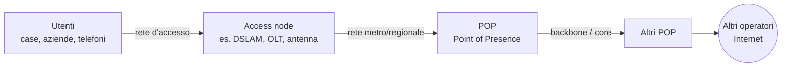
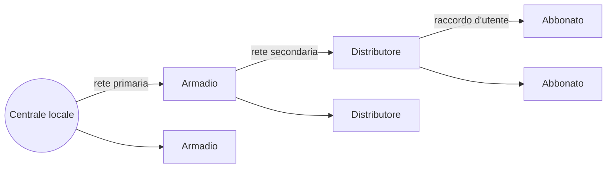

# Lezione 1 – Aree funzionali della rete: accesso, core, backbone

## Di cosa parliamo

Una rete di telecomunicazioni non è un blocco unico: si divide in <b>aree funzionali</b>, ognuna con un compito diverso. Questa lezione introduce la mappa generale che il corso userà sempre: la <b>rete d'accesso</b> (l'ultimo tratto verso l'utente), la <b>rete metropolitana/regionale</b> e la <b>rete core/backbone</b> (la dorsale che collega tutto). Poi passa in rassegna le tecnologie d'accesso (rame, fibra, wireless, satellite), con numeri reali della rete Telecom Italia/TIM.

## 1. La mappa della rete

!!! abstract "In breve"

    Dall'utente verso il centro della rete si attraversano tre strati. La rete d'accesso porta l'utente fino al primo nodo dell'operatore; la rete metropolitana raccoglie il traffico di una città o regione; il backbone collega le città tra loro ad altissima velocità.

- <b>Access node</b>: il primo apparato dell'operatore che l'utente incontra (DSLAM, OLT, stazione radio base).
- <b>POP</b> (<i>Point of Presence</i>): il punto in cui la rete metropolitana entra nel backbone; è un nodo "multiservizio" dove stanno router, BRAS, apparati per la rete mobile, ecc.
- <b>Metropolitan area</b>: la rete che collega gli access node di un'area urbana al POP.
- <b>Backbone</b>: il centro della rete, fatto di router potenti connessi a maglia.

## 2. Rete d'accesso (access network)

!!! abstract "In breve"

    È la parte di rete che collega l'abbonato al suo fornitore di servizio. È il "tratto finale" (o primo, visto dall'utente): il doppino, la fibra o il collegamento radio che arriva a casa tua.

- Si contrappone alla <b>rete core</b>.
- Si può dividere ulteriormente in:
    - <b>feeder plant</b> (o rete di distribuzione primaria): dalla centrale agli armadi stradali;
    - <b>drop plant</b> (o <i>edge network</i>): dagli armadi alle singole case.
- Ruolo: collega operatori e fornitori di servizi con le persone e le aziende che servono.
- Storicamente fatta di <b>linee in rame</b> per il telefono; oggi lo stesso rame porta anche la banda larga (<b>DSL</b>) insieme alla voce.
- Gli operatori investono molto nella <b>fibra ottica</b> per l'accesso fisso, grazie alla sua velocità e stabilità.

## 3. Rete core e edge

### Core network

!!! abstract "In breve"

    La rete core è il "centro" della rete. Raccoglie il traffico che arriva da tutte le reti d'accesso e lo smista ad alta velocità verso la destinazione, che sia un altro utente dello stesso operatore o un'altra rete.

!!! note ""

    <b>Analogia</b>: se la rete d'accesso sono le strade di quartiere che portano a casa tua, la rete core è l'autostrada. Ha pochi ingressi, enorme capacità e collega tutte le città tra loro.

- Topologia tipicamente a <b>maglia</b> (<i>mesh</i>): ci sono più cammini tra due nodi, quindi la rete resiste ai guasti.
- Fornisce connessioni <b>any-to-any</b> tra i dispositivi della rete.
- Fatta di <b>switch</b> (es. ATM, <i>Asynchronous Transfer Mode</i>) oppure di <b>router IP</b>.
- Poggia su un <b>backbone ottico</b>.
- Internet si può vedere come un gigantesco core network: in realtà è fatto di tanti operatori, ognuno con il suo core, <b>interconnessi</b> tra loro.

### Edge (bordo della rete)

!!! abstract "In breve"

    L'edge è il confine tra il core e le reti degli utenti. È lì che si fanno le operazioni "intelligenti" (classificare il traffico, scegliere il percorso), così il core può limitarsi a inoltrare velocemente.

- L'edge può svolgere funzioni che il core <b>non</b> fa.
- <b>Esempio con MPLS</b> (<i>Multiprotocol Label Switching</i>): l'edge switch esamina ogni pacchetto e, in base alle sue proprietà (destinazione, tipo di traffico, ...), sceglie un <b>percorso</b> attraverso la rete e gli attacca un'<b>etichetta</b> (<i>label</i>).
- Il core poi <b>commuta</b> i pacchetti guardando solo l'etichetta, invece di fare <b>routing hop-by-hop</b> (cioè decidere a ogni router guardando l'indirizzo IP). È molto più veloce.
- Paradigma: <b>core "stupido" ed edge "intelligente"</b>: la scelta del percorso la decide l'edge.

## 4. Tipi di accesso

!!! abstract "In breve"

    Ci si può collegare alla rete in tanti modi diversi, a seconda del mezzo fisico: cavo (rame, coassiale, fibra, rete elettrica), onde radio (Wi-Fi, cellulare, 5G) o satellite. Ognuno ha un compromesso tra velocità, copertura, mobilità e costo.

| Tipo | Mezzo | Vantaggi | Usi tipici |
| --- | --- | --- | --- |
| Wired (cablato) | Cavi fisici | Affidabile, stabile, veloce | Ethernet, fibra, DSL |
| Wireless | Onde radio | Mobilità, flessibilità, facile da installare | Wi-Fi, Bluetooth, cellulare |
| Satellitare | Satelliti in orbita | Copertura vastissima, zone remote | Internet rurale, comunicazioni globali |
| Fibra ottica | Fibre di vetro/plastica, luce | Banda altissima, bassa latenza, sicura | Internet veloce, data center |
| DSL | Doppino telefonico | Diffusissimo, economico | Casa, piccole aziende |
| Cavo | Cavo coassiale | Veloce; infrastruttura condivisa | Banda larga residenziale, TV via cavo |
| Cellulare | Reti mobili | Connessione in movimento | Smartphone, dati mobili |
| Powerline | Impianto elettrico | Nessun cavo nuovo | Rete domestica, estendere il Wi-Fi |
| 5G | Rete mobile di 5ª generazione | Velocissima, bassa latenza, IoT, AR/VR | Applicazioni emergenti, smart city |

Nota sul <b>cavo coassiale</b>: "infrastruttura condivisa" significa che più utenti dello stesso ramo si dividono la banda (al contrario del doppino DSL, che è dedicato a un solo abbonato).

## 5. Esempio: la rete Telecom Italia

!!! abstract "In breve"

    Un operatore reale mette insieme tutto: accesso fisso (ADSL, VDSL, fibra) e mobile (HSPA, LTE) convergono su una rete metropolitana ottica, che arriva ai POP e da lì al backbone nazionale.

Tre livelli:

- <b>Access network</b> (aree metropolitane):
    - ADSL2+ (circa 10 Mbit/s) dagli <b>IP-DSLAM</b> (circa 4.000);
    - <b>FTTC</b> con VDSL2 (circa 50 Mbit/s) da <b>IP-MSAN</b> (l'ONU nell'armadio);
    - <b>FTTH/FTTB</b> (100 Mbit/s) tramite <b>GPON</b>;
    - mobile HSPA/LTE/WiMAX (circa 10 Mbit/s).
- <b>Regional/metropolitan network</b>: anelli <b>ottici a pacchetto</b> (<i>optical packet metro</i>) che raccolgono il traffico.
- <b>Multiservice edge node (POP)</b>: contiene gli apparati di bordo:
    - per il mobile: MSC-S, xGSN, RNC (lato <b>RAN/CN</b>, rete radio e core mobile);
    - per la banda larga fissa (<b>BBAN edge</b>): <b>DPI</b> (<i>Deep Packet Inspection</i>), <b>BRAS</b> (<i>Broadband Remote Access Server</i>, termina le sessioni PPP degli utenti), <b>PE</b> (<i>Provider Edge</i> router, il bordo MPLS);
    - storage.
- <b>Backbone network</b>: l'<b>optical packet backbone</b>, un anello di router ad alta capacità.

## 6. Terminologia storica (USA)

!!! abstract "In breve"

    Nella telefonia americana si distingue chi gestisce le chiamate locali (LEC) da chi gestisce quelle a lunga distanza (IXC). Questi termini si incontrano ancora spesso.

- <b>Exchange area</b>: area servita da una centrale; si distingue traffico <b>locale</b> e a <b>lunga distanza</b>.
- <b>LEC</b> (<i>Local Exchange Carrier</i>): operatore della telefonia locale.
    - <b>ILEC</b> (<i>Incumbent LEC</i>): l'operatore storico, ex monopolista (in Italia il corrispondente è Telecom Italia/TIM).
    - <b>CLEC</b> (<i>Competitive LEC</i>): operatore concorrente, nato dopo la liberalizzazione.
- <b>CO</b> (<i>Central Office</i>): la centrale telefonica.
- <b>Trunk</b>: collegamenti tra centrali, in fibra ottica.
- <b>LATA</b> (<i>Local Access and Transport Area</i>): area geografica di traffico locale.
- <b>IXC</b> (<i>Inter-exchange Carrier</i>): operatore che trasporta il traffico <b>tra LATA diverse</b> (lunga distanza).

Nello schema del prof:

- <b>dominio LEC</b> = <b>rete d'accesso (locale)</b>: telefoni → <i>distribution network</i> → <b>Remote Terminal (RT)</b> o <b>central end office</b> → <i>feeder network</i> → <b>central tandem office</b> (centrale di transito);
- poi una <b>rete regionale</b> fino al <b>POP</b> dell'IXC;
- <b>dominio IXC</b> = <b>rete a lunga distanza</b>: anello di <b>tandem switch</b>.

### Esempi fisici

- <b>Distribution frame</b> (permutatore): il telaio in centrale dove i doppini vengono collegati <b>uno per uno</b> agli apparati della centrale.
- <b>Collocation space</b>: spazio nella centrale dove i <b>CLEC</b> possono installare i loro apparati. È ciò che permette la concorrenza: un operatore alternativo affitta il doppino dell'incumbent (<i>unbundling</i>) e lo collega al suo DSLAM in centrale.

## 7. La rete di distribuzione in rame

!!! abstract "In breve"

    Dalla centrale locale partono cavi grossi verso gli armadi stradali; dagli armadi partono cavi più piccoli verso i distributori (vicino agli edifici); dai distributori parte il doppino del singolo abbonato. È una struttura ad albero.

- <b>Centrale locale</b> → <b>armadio ripartilinea</b> (cabinet) → <b>distributore</b> → <b>abbonato</b> (borchia, cioè la presa a muro).

### Numeri della rete d'accesso Telecom Italia (2007)

| Elemento | Quantità | Unità |
| --- | --- | --- |
| Borchie d'utente (prese) | 33.576.000 | numero |
| Distributori | 3.893.000 | numero |
| Armadi ripartilinea | 142.500 | numero |
| Cavi a coppie simmetriche | 105.700.000 | km-circuito |
| Cavi (tracciato) | 575.000 | km |
| Palificazioni | 8.893.000 | pali |
| Infrastrutture di posa | 20.000 | km di tubazioni |

Differenza tra le due righe sui cavi: il <b>tracciato</b> (575.000 km) è la lunghezza dei percorsi fisici; i <b>km-circuito</b> (105,7 milioni) contano ogni coppia separatamente (un cavo da 100 coppie lungo 1 km vale 100 km-circuito).

## 8. Accesso in rame

!!! abstract "In breve"

    La rete in rame dell'operatore storico porta sia la banda larga (ADSL, VDSL) sia il telefono. Il suo punto di forza è che c'è già ovunque; il suo limite è che è stata progettata per la voce, non per i dati.

- Fornisce banda larga (<b>ADSL, VDSL</b>) e telefono tradizionale; la voce può migrare verso IP mantenendo la stessa qualità.
- <b>Vantaggio principale</b>: diffusione capillare. Riusare l'infrastruttura esistente è molto competitivo, soprattutto nelle aree ben coperte.
- Di solito è gestita dall'<b>operatore incumbent</b>, spesso (storicamente) a proprietà pubblica.
- <b>Problemi</b>:
    - è cresciuta un pezzo alla volta nel corso di decenni: l'architettura <b>non è ottimizzata</b> per le tecnologie attuali;
    - se si costruisse oggi una rete da zero, <b>non</b> sarebbe in rame e avrebbe un progetto molto diverso;
    - è pensata per il <b>POTS</b> (telefono), mentre il traffico è sempre più <b>IP</b>: in alcune zone ci sono problemi di capacità e di qualità del servizio.

## 9. Accesso in fibra (FTTx)

### Accesso ottico

!!! abstract "In breve"

    La fibra sarà (ed è già) la scelta principale per l'accesso fisso nei prossimi anni, perché porta velocità altissime in modo affidabile.

Sistemi citati:

- <b>GE-PON</b> (<i>Gigabit Ethernet PON</i>): per utenti residenziali;
- <b>GPON</b> (<i>Gigabit PON</i>): per aziende (in Italia è usata anche per le case);
- <b>COF</b> (<i>Code Division Multiplexing over Fiber</i>): per lunghe distanze.

<b>PON</b> = <i>Passive Optical Network</i> (sezione 9.3).

### FTTx: fin dove arriva la fibra

!!! abstract "In breve"

    FTTx = <i>Fiber To The x</i>. La x dice <b>fin dove</b> arriva la fibra; dopo quel punto il segnale prosegue su rame (o radio). Più la x è vicina all'utente, più la connessione è veloce.

- <b>FTTH</b> – Home (fino in casa)
- <b>FTTC</b> – Curb (fino al marciapiede/armadio)
- <b>FTTN</b> – Node o Neighborhood (fino a un nodo di quartiere)
- <b>FTTP</b> – Premises (fino alla proprietà dell'utente)
- <b>FTTB</b> – Building o Business (fino all'edificio)
- <b>FTTU</b> – User
- <b>FTTZ</b> – Zone
- <b>FTTO</b> – Office
- <b>FTTD</b> – Desk (fino alla scrivania)

### Architettura di riferimento

!!! abstract "In breve"

    In centrale c'è l'OLT, il trasmettitore ottico dell'operatore. Da lì la fibra si dirama (rete ODN) fino alle ONU/ONT vicine o dentro le case. Se la fibra non arriva in casa, l'ONU converte il segnale e prosegue in rame con xDSL.

- <b>OLT</b> (<i>Optical Line Terminal</i>): terminale ottico in centrale, lato operatore.
- <b>ODN</b> (<i>Optical Distribution Network</i>): la rete di fibre e splitter tra OLT e utenti.
- <b>ONU</b> (<i>Optical Network Unit</i>): converte da ottico a elettrico in un punto intermedio (armadio, edificio). Se dopo c'è rame, l'ONU contiene un modem <b>xDSL</b> che parla con l'<b>NT</b> dell'utente sul doppino (<i>cp</i>, coppia in rame).
- <b>ONT</b> (<i>Optical Network Termination</i>): l'ONU quando sta <b>dentro casa</b> dell'utente (FTTH). <b>NT</b> = <i>Network Termination</i>, il punto di terminazione della rete.

### AON vs PON

!!! abstract "In breve"

    Due modi per distribuire la fibra. <b>AON</b>: ogni utente ha la sua fibra, oppure c'è un nodo attivo (alimentato) che smista. <b>PON</b>: una fibra si divide passivamente in tante con splitter ottici, senza apparati alimentati in mezzo.

<b>AON</b> (<i>Active Optical Network</i>), detta anche <b>Point-to-Point (P2P)</b>:

- (a) una fibra <b>dedicata</b> dalla centrale a ogni utente/armadio/edificio, oppure
- (b) una fibra fino a un <b>nodo attivo</b> (switch alimentato) che poi distribuisce con fibre dedicate.
- Pro: banda dedicata, semplice. Contro: tante fibre in centrale, apparati attivi da alimentare e mantenere.

<b>PON</b> (<i>Passive Optical Network</i>):

- una fibra dalla centrale arriva a uno <b>splitter/combiner ottico passivo</b> (nessuna alimentazione) che divide la potenza ottica su più fibre, con topologia <b>ad albero</b>.
- Pro: meno fibre e nessun apparato attivo sul campo, quindi costi bassi. Contro: la banda della fibra iniziale è <b>condivisa</b> tra gli utenti dello stesso albero.

In entrambe, gli ultimi metri possono essere FTTCab/FTTC (poi rame da meno di 300 m fino a 4 km), FTTH o FTTB.

### FTTE, FTTCab, FTTCurb

!!! abstract "In breve"

    Più vicino all'utente si mette l'ONU, più corto è il rame, più alta la velocità.

| Architettura | Dove finisce la fibra | Tratto in rame (TIM) | Tecnologia sul rame |
| --- | --- | --- | --- |
| FTTE (Exchange) | Centrale (CO) | 1,2 – 1,5 km | ADSL |
| FTTCab (Cabinet) | ONU nell'armadio stradale | 200 – 300 m | VDSL |
| FTTCurb | ONU sul marciapiede/palo | 50 – 150 m | VDSL |

Le foto della slide 24 mostrano gli <b>armadi stradali</b> (con i doppini attestati sulle morsettiere), una <b>muffola/box ottico</b> in posa e un <b>box su palo</b> (tipico del FTTCurb).

### FTTP: FTTB e FTTH

!!! abstract "In breve"

    Nel FTTP la fibra arriva fino alla proprietà dell'utente. Nel FTTB si ferma alla base dell'edificio (poi rame o radio negli ultimi metri); nel FTTH entra in ogni appartamento.

- <b>FTTB</b> (<i>Building</i>): fibra fino a un'<b>ONU</b> nell'edificio; dentro l'edificio si prosegue con <b>VDSL, Ethernet o wireless</b>.
- <b>FTTH</b> (<i>Home</i>): fibra fino a un elemento ottico (splitter) nell'edificio e poi fibra fino a un'<b>ONT</b> in ogni appartamento.

### Accesso cablato: quadro complessivo (Telecom Italia)

Distanze e numero di nodi lungo il percorso:

|  | Exchange | Cabinet | Curb | Premises |
| --- | --- | --- | --- | --- |
| Quanti (circa) | 10 mila | 140 mila | 5 milioni | 22 milioni |

Distanze: centrale → armadio 1–1,2 km; armadio → curb 200–300 m; curb → casa 50–70 m; in totale 1,2–1,5 km.

| Soluzione | In centrale | Collegamento | A casa |
| --- | --- | --- | --- |
| Banda larga attuale | DSLAM / aggregazione ATM | Rame fino a casa: ADSL/ADSL2+ | Modem DSL |
| FTTCab | Aggregazione | Fibra fino al DSLAM nell'armadio, poi rame VDSL/VDSL2 | Modem DSL + set-top + home gateway |
| FTTCurb | Aggregazione | Fibra (GE/EPON/GPON) fino all'ONU sul curb, poi rame VDSL2 | Modem DSL + set-top + home gateway |
| FTTH | OLT | Fibra (GE/EPON/GPON) fino a casa | ONT + set-top + home gateway |

## 10. Quanta banda serve

!!! abstract "In breve"

    Servizi diversi chiedono velocità diverse, sia in download sia in upload. ADSL basta per navigare; per video HD, storage remoto o TV 3D serve fibra.

Dal grafico TIM (stime, in Mbit/s):

- <b>ADSL/2+</b> basta per: web surfing, videochiamate, SDTV VoD, peer-to-peer, SDTV live.
- <b>FTTCab VDSL2</b> serve per: gaming e didattica a distanza, web hosting, telemedicina (che chiedono anche <b>upload</b> alto).
- <b>FTTB VDSL2</b>: HDTV VoD.
- <b>FTTH</b>: remote storage (molto upload e download, fino a 50+ Mbit/s per lato) e TV 3D di nuova generazione (circa 100 Mbit/s in download).

Idea chiave: l'<b>upload</b> diventa importante con servizi come hosting, storage, telemedicina; ed è proprio l'upload il punto debole di ADSL.

### Evoluzione: dal rame alla fibra

Il passaggio avviene per gradi:

1. <b>FTTE</b>: tutta la rete d'accesso in rame (fibra solo fino alla centrale).
2. Mix: <b>FTTCab</b> in alcune zone, <b>FTTB</b> e <b>FTTH</b> in altre, FTTE nel resto.
3. <b>FTTH</b> ovunque: l'accesso è tutto in fibra.

### Numeri di oggi

- Dati aperti su [rete.gruppotim.it](https://rete.gruppotim.it/): mappa delle centrali con OLT (pronte per la fibra), collegamenti in fibra e in ponte radio. Nella zona di Roma: copertura ADSL 100% delle abitazioni, copertura <b>NGAN</b> (<i>Next Generation Access Network</i>) 91,8%, 4G nel 91,7% dei comuni.
- Altre fonti: [fibercop.it](https://www.fibercop.it/en/) (la società che oggi gestisce la rete d'accesso ex TIM), [bandaultralarga.italia.it](https://bandaultralarga.italia.it/).
- Mappe per regione (dati SOStariffe, fine 2022):
    - copertura <b>FTTH</b>: bassa, circa 3–20% per regione (es. Lazio circa 9,5%);
    - copertura <b>FTTC</b>: circa 47–76% (es. Lazio circa 52,7%);
    - <b>digital divide</b>: quota di popolazione <b>non</b> raggiunta da 30 Mbit/s: Italia 77,7% contro una media europea del 36%.

## 11. Accesso wireless

!!! abstract "In breve"

    L'accesso radio è quello su cui ci sono più aspettative per una rete "ovunque": niente cavi, mobilità, e sempre più velocità.

Tecnologie:

- <b>WLL</b> (<i>Wireless Local Loop</i>): sostituisce il doppino con un collegamento radio tra una stazione base (collegata alla centrale o via satellite) e unità fisse presso gli abbonati, a cui si collegano telefono, fax, modem. Utile dove posare cavi costa troppo.
- <b>3G</b> (reti mobili di terza generazione).
- <b>WiMAX</b> (IEEE 802.16).
- Obiettivo: comunicazioni continue e banda larga, con accesso <b>fisso e mobile in un unico sistema</b>.

### Architettura 2G e 3G

!!! abstract "In breve"

    La rete mobile ha una parte radio (antenne e i loro controllori) e una parte core (centrali che gestiscono chiamate, dati e database degli utenti).

<b>Parte radio (RAN)</b>:

- <b>2G (GSM)</b>: <b>BTS</b> (<i>Base Transceiver Station</i>, l'antenna) controllate da una <b>BSC</b> (<i>Base Station Controller</i>).
- <b>3G (UMTS)</b>: <b>Node B</b> (l'antenna) controllati da un <b>RNC</b> (<i>Radio Network Controller</i>). Il telefono è la <b>MS</b> (<i>Mobile Station</i>) = <b>ME</b> (<i>Mobile Equipment</i>, il terminale) + <b>USIM</b> (la SIM).
- Interfacce 3G: <b>Uu</b> (radio, telefono ↔ Node B), <b>Iub</b> (Node B ↔ RNC), <b>Iur</b> (RNC ↔ RNC).
- Il territorio è diviso in <b>celle</b>; più celle formano l'area di un RNC.

<b>Parte core</b>:

- <b>Circuit Switched (CS)</b>, per la voce: <b>MSC</b> (<i>Mobile Switching Center</i>), con i database <b>HLR</b> (<i>Home Location Register</i>: profilo e posizione di tutti gli abbonati) e <b>VLR</b> (<i>Visitor Location Register</i>: utenti attualmente nell'area di quell'MSC). Collegamento RNC ↔ MSC: <b>Iu-CS</b>.
- <b>Packet Switched (PS)</b>, per i dati: <b>SGSN</b> (<i>Serving GPRS Support Node</i>) e <b>GGSN</b> (<i>Gateway GPRS Support Node</i>, il gateway verso Internet), collegati dall'interfaccia <b>Gn</b>. Collegamento RNC ↔ SGSN: <b>Iu-PS</b>.

Numeri (rete TIM, slide):

|  | GSM (2G) | UMTS (3G) |
| --- | --- | --- |
| Siti (tralicci) | 14.000 | 8.030 |
| Stazioni radio | 13.865 BTS (13.863 macro + 1.150 micro nello schema) | 8.030 Node B (8.000 macro + 50 micro) |
| Controllori | 463 BSC | 70 RNC |
| Trasmettitori | 90.090 | – |
| Celle | 24.522 (900 MHz) + 7.551 (1800 MHz) | 22.094 |
| Canali | 556.264 (900 MHz) + 164.458 (1800 MHz) | 834.752 |
| Frequenze | 900 e 1800 MHz | 10 MHz a 2100 MHz |

### Rete 5G

!!! abstract "In breve"

    Nel 5G il core è diviso in funzioni software separate. Il <b>piano di controllo</b> (chi sei, dove sei, che sessione hai) è separato dal <b>piano utente</b> (dove passano davvero i tuoi dati).

- <b>UE</b> (<i>User Equipment</i>): il terminale.
- <b>gNB</b>: la stazione radio base 5G (fa parte della <b>5G RAN</b>).
- <b>5G Core (5GC)</b>:
    - <b>AMF</b> (<i>Access and Mobility Management Function</i>): gestisce accesso e mobilità (registrazione, handover). Piano di controllo.
    - <b>SMF</b> (<i>Session Management Function</i>): crea e gestisce le sessioni dati. Piano di controllo.
    - <b>UPF</b> (<i>User Plane Function</i>): inoltra i pacchetti dell'utente verso Internet. Piano utente.
- Interfacce: <b>N2</b> (gNB ↔ AMF, controllo), <b>N3</b> (gNB ↔ UPF, dati), <b>N4</b> (SMF ↔ UPF, l'SMF configura l'UPF), <b>N6</b> (UPF ↔ Internet).

### Copertura mobile in Italia

- [Mappa copertura TIM](https://www.tim.it/fisso-e-mobile/mobile/mappa-copertura-mobile)
- [OpenSignal coverage maps](https://www.opensignal.com/coverage-maps): mappe costruite in <b>crowdsourcing</b> dalle misure dell'app installata sugli smartphone degli utenti (la mappa di Roma mostra zone verdi di segnale forte e rosse di segnale debole). Il prof suggerisce di provare l'app.

### Evoluzione degli standard mobili

| Periodo | Famiglia 3GPP (GSM) | Famiglia 3GPP2 (CDMA) | IEEE |
| --- | --- | --- | --- |
| Prima del 2000 | GSM/PDC, GPRS/PDC-P, EDGE | IS-95 | – |
| 2000–2010 | UMTS, HSDPA, HSUPA | CDMA2000, 1X/nX EV-DO | Mobile WiMAX (dal 2007) |
| Dal 2010 | LTE | UMB | WiMAX phase 2, 3 |

(Storicamente ha vinto LTE; UMB e WiMAX mobile sono stati abbandonati.)

### Famiglie wireless per estensione

!!! abstract "In breve"

    Le reti wireless si classificano per raggio di copertura, dal piccolissimo (attorno al corpo) al regionale.

| Tipo | Copertura | Standard |
| --- | --- | --- |
| PAN (Personal) | Pochi metri | IEEE 802.15 (WiMedia, Bluetooth) |
| LAN (Local) | Casa, ufficio | IEEE 802.11 (Wi-Fi) |
| MAN (Metropolitan) | Città | IEEE 802.16 (WiMAX fisso e mobile, "wireless DSL") |
| RAN (Regional) | Regione | IEEE 802.22 (WRAN, usa le frequenze TV libere) |

Tendenza: con il servizio <b>anytime, anywhere, anyone</b>, alla telefonia cellulare e al Wi-Fi si aggiunge la richiesta di <b>banda larga mobile</b> e comunicazioni senza interruzioni.

### Evoluzione del Wi-Fi

| Nome | Standard | Anno | Velocità max |
| --- | --- | --- | --- |
| Wi-Fi 1 | 802.11 | 1997 | 2 Mbit/s |
| Wi-Fi 2 | 802.11b | 1999 | 11 Mbit/s |
| Wi-Fi 3 | 802.11g | 2003 | 54 Mbit/s |
| Wi-Fi 4 | 802.11n | 2008 | 600 Mbit/s |
| Wi-Fi 5 | 802.11ac | 2014 | 6,9 Gbit/s |
| Wi-Fi 6 | 802.11ax | 2019 | 9,6 Gbit/s |

Oltre alla velocità cresce il numero di utenti serviti contemporaneamente (Wi-Fi 6 è pensato per ambienti affollati).

## 12. Accesso satellitare: LEO

!!! abstract "In breve"

    I satelliti LEO orbitano bassi (poche centinaia di km), quindi il segnale fa un viaggio breve e la latenza è bassa. Ma ogni satellite copre una zona piccola e si muove velocemente: ne servono migliaia per coprire la Terra.

<b>LEO</b> (<i>Low Earth Orbit</i>):

- quota circa <b>500–2000 km</b>;
- periodo orbitale breve, circa <b>90–120 minuti</b>;
- <b>bassa latenza</b> rispetto ai satelliti GEO;
- servono <b>grandi costellazioni</b> per una copertura continua;
- applicazioni: accesso a Internet, osservazione della Terra, IoT, navigazione;
- bande <b>Ku</b> (12–18 GHz) e <b>Ka</b> (circa 26,5–40 GHz; la slide riporta per errore 12–18 GHz anche per la Ka).

<b>Vantaggi</b>: latenza circa 20–40 ms (contro 500+ ms del GEO), alta banda potenziale, copertura globale anche in zone rurali e remote.

<b>Sfide</b>: migliaia di satelliti necessari, costi di lancio e manutenzione alti, rischio <b>detriti spaziali</b> e vita breve dei satelliti (circa 5–7 anni).

### LEO vs GEO

|  | LEO | GEO (geostazionario) |
| --- | --- | --- |
| Quota | 500 – 2000 km | circa 35.786 km |
| Latenza | circa 20 – 40 ms | circa 500+ ms |
| Copertura | Servono grandi costellazioni | Un satellite copre circa 1/3 della Terra |
| Vita | circa 5 – 7 anni | circa 15 anni |

<b>Perché la latenza GEO è così alta</b> (<i>complemento</i>): il segnale va utente → satellite → stazione a terra, cioè circa $2 \times 35.786$ km. Alla velocità della luce ($3 \cdot 10^5$ km/s) sono circa 240 ms solo andata; andata e ritorno di una richiesta superano i 480 ms. Un GEO è "fermo" nel cielo perché ruota con la Terra (periodo 24 h).

### Esempio: Starlink

- Costellazione LEO di <b>SpaceX</b>, oltre 5.000 satelliti lanciati (dato 2025).
- Obiettivo: banda larga globale per case, aziende e mezzi in movimento (navi, aerei).
- Terminale utente: piccola antenna ("Dishy"); latenza 20–40 ms.

## 13. Tecnologie e velocità nel tempo

| Fisso | Velocità tipica | Mobile | Velocità tipica |
| --- | --- | --- | --- |
| Dial-up | circa 64 kbit/s | GSM | circa 10 kbit/s |
| ADSL free | 256 – 640 kbit/s | EDGE | circa 100 kbit/s |
| ADSL flat | 2 – 6 Mbit/s | UMTS | circa 300 kbit/s |
| ADSL2+ | 10 – 20 Mbit/s | HSPA 1 / 2 / 2+ | 3 / 7 / 14 Mbit/s |
| VDSL2 | 50 – 100 Mbit/s | – | – |

## 14. Il backbone Telecom Italia

### Topologia logica: OPB

!!! abstract "In breve"

    Il backbone IP di TIM (OPB, <i>Optical Packet Backbone</i>) è fatto di 32 POP. Quattro, a Roma e Milano, formano il "cuore" collegato a 10 Gbit/s; gli altri si appoggiano a questi.

- <b>32 PoP</b> in tutto:
    - <b>Inner core</b>: 4 PoP (2 a Roma, 2 a Milano), collegati a <b>10 Gbit/s (STM-64)</b>;
    - <b>Outer core</b>: 28 PoP, collegati a 10 Gbit/s (STM-64), <b>2,5 Gbit/s (STM-16)</b> o <b>155 Mbit/s (STM-1)</b>.
- Ogni PoP è in <b>dual homing</b>: collegato a due nodi dell'inner core (es. Roma e Milano), così sopravvive al guasto di uno dei due.
- Circa 100 router Cisco GSR (<i>Gigabit Switch Router</i>).
- Capacità: circa 80 Gbit/s interni, 13 Gbit/s verso la "Big Internet", 12 Gbit/s di peering pubblici e privati.
- I link sono usati al <b>50%</b>: margine per assorbire il traffico se un collegamento si guasta (il dual homing ha senso solo se il link superstite regge il traffico dell'altro).

<b>STM-n</b> (<i>Synchronous Transport Module</i>, gerarchia SDH): STM-1 = 155 Mbit/s, STM-16 = 2,5 Gbit/s, STM-64 = 10 Gbit/s (ogni livello è un multiplo di STM-1).

### Topologia fisica

- La rete IP poggia sulla <b>rete di trasporto ottica</b> (OTN).
- Nodi con <b>ODXC</b> (<i>Optical Digital Cross Connect</i>): commutano interi flussi ottici.
- Collegamenti in <b>DWDM</b> (<i>Dense Wavelength Division Multiplexing</i>: molte lunghezze d'onda, cioè molti canali, sulla stessa fibra) o fibra ottica.
- Topologia a <b>maglia</b> che copre tutta Italia (TO, MI, VE, BO, FI, RM, NA, BA, Lamezia, PA, CT, ...).

<b>Differenza logica vs fisica</b>: la topologia logica dice quali router IP si "vedono" direttamente; la fisica dice dove passano davvero le fibre. Un singolo link logico Roma–Milano può attraversare fisicamente più nodi ottici.

### Infrastrutture globali

- [submarinecablemap.com](http://www.submarinecablemap.com/): mappa dei <b>cavi sottomarini</b> che collegano i continenti; la quasi totalità del traffico intercontinentale passa da qui, non dai satelliti.

## 15. Gartner hype cycle

!!! abstract "In breve"

    Un modello che descrive come cresce l'attenzione verso una nuova tecnologia: prima entusiasmo eccessivo, poi delusione, poi maturità e adozione reale. Serve a non confondere l'hype con l'utilità effettiva.

Cinque fasi (aspettative in funzione del tempo):

1. <b>Technology trigger</b>: ricerca, prime startup e primi finanziamenti, prodotti di prima generazione costosi e da personalizzare.
2. <b>Peak of inflated expectations</b>: hype mediatico, tanti fornitori, attività oltre gli early adopter.
3. <b>Trough of disillusionment</b>: stampa negativa, fallimenti e consolidamento dei fornitori; meno del 5% del pubblico potenziale ha adottato davvero.
4. <b>Slope of enlightenment</b>: prodotti di seconda e terza generazione, metodologie e best practice.
5. <b>Plateau of productivity</b>: adozione di massa (20–30% del pubblico potenziale).

<b>Hype cycle 2024</b> (tecnologie emergenti, agosto 2024):

- in salita (innovation trigger): Large Action Models, robot umanoidi, digital twin, <b>6G</b>, cybersecurity mesh architecture, sistemi multi-agente, AI supercomputing, agenti autonomi, reinforcement learning, AGI, federated learning;
- vicino al picco: <b>homomorphic encryption</b>, prompt engineering, AI TRiSM, GitOps, superapps, AI per l'ingegneria del software;
- in discesa verso la disillusione: <b>generative AI</b>, WebAssembly, cloud-native.

## Domande di ripasso

??? note "Che differenza c'è tra rete d'accesso e rete core?"

    L'accesso collega il singolo abbonato al primo nodo dell'operatore (rame, fibra, radio): è capillare, con tantissimi collegamenti a bassa capacità. Il core è la dorsale: pochi nodi potenti a maglia, collegamenti ad altissima capacità, connessioni any-to-any.

??? note "Perché si dice 'core stupido, edge intelligente'?"

    Con MPLS l'edge esamina i pacchetti, sceglie il percorso e assegna un'etichetta; il core commuta solo in base all'etichetta, senza routing hop-by-hop. Le decisioni sono al bordo, il centro è veloce e semplice.

??? note "Differenza tra AON e PON?"

    AON (P2P): fibra dedicata per utente o nodo attivo alimentato che distribuisce. PON: splitter ottici passivi, topologia ad albero, banda condivisa tra gli utenti dello stesso ramo, nessun apparato alimentato sul campo, costi più bassi.

??? note "FTTE, FTTCab, FTTH: quanto rame resta?"

    FTTE: 1,2–1,5 km di rame (ADSL). FTTCab: 200–300 m (VDSL). FTTCurb: 50–150 m (VDSL). FTTH: nessuno, fibra fino all'ONT in casa.

??? note "Perché un satellite LEO ha latenza molto più bassa di uno GEO?"

    Perché è circa 20–70 volte più vicino alla Terra (500–2000 km contro 35.786 km): la propagazione è molto più breve. In cambio copre un'area piccola e si muove, quindi servono migliaia di satelliti.

??? note "Perché i link del backbone TIM sono usati solo al 50%?"

    Per la protezione: con il dual homing, se un collegamento si guasta il traffico passa sull'altro, che deve poter reggere anche il carico del primo.

## Riepilogo

- Rete = <b>accesso</b> (utente → primo nodo) + <b>metro/regionale</b> + <b>core/backbone</b> (dorsale a maglia, any-to-any).
- <b>Edge intelligente, core veloce</b> (MPLS: l'edge sceglie il percorso, il core commuta per etichetta).
- <b>Tipi di accesso</b>: rame (DSL), coassiale, fibra, powerline, Wi-Fi, cellulare/5G, satellite.
- <b>Rame</b>: c'è ovunque, ma è pensato per la voce e non ottimizzato per IP. Struttura: centrale → armadio → distributore → presa.
- <b>Fibra (FTTx)</b>: OLT → ODN → ONU/ONT. <b>AON</b> (punto-punto o nodo attivo) vs <b>PON</b> (splitter passivi, banda condivisa). FTTE / FTTCab / FTTCurb / FTTB / FTTH: più vicina la fibra, più corto il rame, più velocità.
- <b>Mobile</b>: 2G (BTS/BSC), 3G (Node B/RNC, MSC per la voce, SGSN/GGSN per i dati), 5G (gNB + AMF/SMF/UPF, controllo separato dai dati).
- <b>Satellite LEO</b>: bassa quota e latenza (20–40 ms), servono grandi costellazioni (Starlink); GEO: un satellite copre 1/3 della Terra ma latenza 500+ ms.
- <b>Backbone TIM</b>: 32 PoP, inner core Roma/Milano a 10 Gbit/s, dual homing, link al 50%; sotto c'è la rete ottica DWDM.
