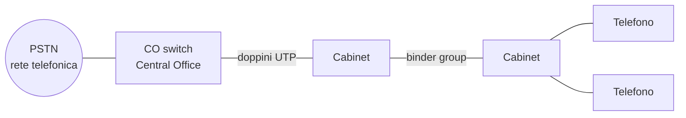
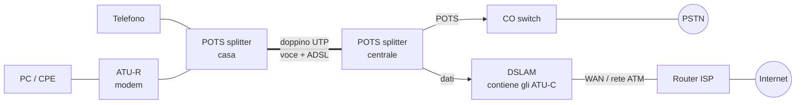
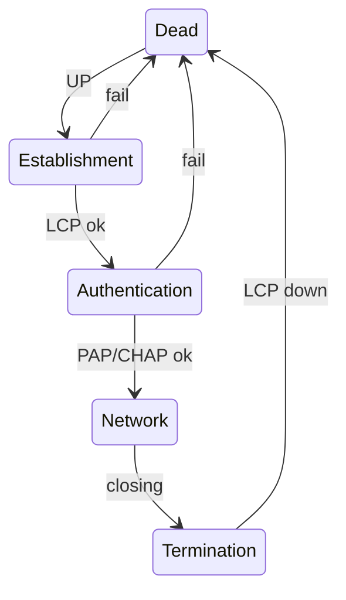

# Lezione 2 – xDSL (ADSL, VDSL) e PPP

## Di cosa parliamo

La <b>rete d'accesso</b> è l'ultimo tratto di rete, quello che collega casa tua alla centrale dell'operatore. In Italia (e nel mondo) per decenni questo tratto è stato un <b>doppino di rame</b> pensato solo per la voce.

La famiglia <b>xDSL</b> è l'insieme di tecnologie che riusano quel doppino per trasportare dati digitali ad alta velocità, senza rifare i cavi. La lezione spiega: perché il doppino ha dei limiti, come ADSL e VDSL li aggirano (bande di frequenza, modulazione DMT, gestione del crosstalk), com'è fatta l'architettura (modem, splitter, DSLAM) e quali protocolli girano sopra (ATM, PPP).

## 1. Cos'è xDSL

!!! abstract "In breve"

    DSL = usare il normale filo del telefono per mandare dati digitali, sfruttando frequenze molto più alte di quelle della voce. La "x" sta per "una delle tante varianti".

- <b>DSL</b> = <i>Digital Subscriber Loop</i> (in origine) o <i>Digital Subscriber Line</i> (nome più commerciale). Il <b>subscriber loop</b> (o <i>local loop</i>) è il doppino che va dalla centrale all'abbonato.
- <b>xDSL</b> = la famiglia: la x indica la variante.

### Spiegato semplice

DSL è la tecnologia che permette di avere <b>Internet sul normale filo del telefono di casa</b>. L'"ADSL" che quasi tutti avevano in casa negli anni 2000–2010 è una delle sue versioni.

<b>L'idea di base</b>

- Ogni casa è collegata alla centrale con un <b>doppino di rame</b>: due fili intrecciati, nati più di cento anni fa solo per il telefono.
- La voce al telefono usa solo le frequenze <b>basse</b> (da 0 a circa 4 kHz). Il filo però riesce a trasportare frequenze molto più alte, fino a qualche MHz, che per il telefono restavano <b>inutilizzate</b>.
- La DSL sfrutta quelle frequenze alte per i dati. Sullo stesso filo viaggiano due cose insieme senza disturbarsi: <b>in basso la voce</b>, <b>in alto i dati di Internet</b>.

<b>Analogia</b>: è come una strada con più corsie. Prima si usava solo la corsia lenta (la voce); la DSL apre le corsie veloci, che c'erano già ma nessuno usava.

<b>Cosa serve per farla funzionare</b>

- <b>A casa</b>: il <b>modem DSL</b> (il router dell'operatore), che trasforma i dati del PC in segnali ad alta frequenza e viceversa, più dei <b>filtri</b> (splitter o microfiltri) sulle prese del telefono che separano voce e dati.
- <b>In centrale</b>: il <b>DSLAM</b>, il "modem dall'altra parte" per centinaia di utenti, che manda il loro traffico verso Internet.

<b>Perché è stata un successo</b>: il doppino arrivava <b>già in tutte le case</b>. Niente scavi né cavi nuovi: bastavano un modem a casa e un DSLAM in centrale.

<b>Il suo limite</b>: le frequenze alte si "consumano" lungo il filo. Più sei lontano dalla centrale, più il segnale arriva debole e più la velocità scende.

- <b>ADSL</b>: circa 8–20 Mbit/s se sei vicino alla centrale.
- <b>VDSL</b>: 50–100 Mbit/s, ma solo con pochi metri di rame. Per questo si porta la fibra fino all'armadio stradale vicino a casa ("fibra misto rame", <b>FTTCab</b>) e il rame si usa solo per l'ultimo tratto.

Il resto della lezione spiega come tutto questo funziona nel dettaglio: bande di frequenza, modulazione DMT, crosstalk.

| Sigla | Nome | Idea chiave |
| --- | --- | --- |
| IDSL | ISDN DSL | DSL sulla linea ISDN |
| HDSL | High data rate DSL | Simmetrica, nata per sostituire le linee T1 |
| SDSL / SHDSL | Symmetric DSL | Versione standardizzata di HDSL |
| ADSL | Asymmetric DSL | Download molto più veloce dell'upload |
| ADSL lite (G.lite) | – | ADSL ridotta, senza splitter |
| RADSL | Rate-Adaptive DSL | Adatta la velocità alla qualità della linea |
| VDSL / VDSL2 | Very high speed DSL | Molto veloce ma solo su tratte di rame corte |

### Perché ha avuto successo

- Esistono <b>oltre 600 milioni</b> di doppini nel mondo: l'infrastruttura c'è già, rifarla costa enormemente.
- Domanda crescente di trasmissione dati (soprattutto accesso a Internet/IP).
- <b>Concorrenza</b> e <b>deregolamentazione</b> del mercato telecom.
- Domanda di telefonia base (POTS) nei paesi in via di sviluppo.

<b>POTS</b> = <i>Plain Old Telephone Service</i>, il telefono analogico tradizionale.

### Esempio: la rete in rame di Telecom Italia

- 33.576.600 terminazioni di rete (linee)
- 11.000 centrali (<b>CO</b>, <i>Central Office</i>)
- 150.000 armadi stradali (<b>cabinet</b>)
- oltre 105,7 milioni di km-coppia di cavo
- distanza media centrale-utente: <b>1,5 km</b> (1,2 km in città)

Quest'ultimo numero conta molto: come vedremo, la velocità DSL crolla con la distanza.

### Un po' di storia

- Anni '80: nasce l'idea di una linea digitale d'abbonato per l'accesso <b>ISDN</b> (rete digitale integrata), a 160 kbit/s. Poi si punta a velocità vicine al <b>T1</b> (1,544 Mbit/s): progetto <b>HDSL</b>.
- Poi interesse per l'<b>asimmetria</b>, pensando al Video on Demand.
- <b>1988</b>: Joe Lechleider (Bellcore) inventa l'<b>ADSL</b>: mette il segnale dati a larga banda <b>sopra</b> la banda della voce analogica, sullo stesso doppino. Voce e dati convivono.

## 2. Il doppino e i suoi limiti

### La rete d'accesso prima del DSL

!!! abstract "In breve"

    Dalla centrale escono tantissimi doppini, raggruppati in grossi cavi, che passano per armadi stradali e arrivano alle case. Dentro la centrale c'era solo lo switch telefonico.



- <b>UTP</b> (<i>Unshielded Twisted Pair</i>): coppia di fili di rame intrecciati, non schermati.
- <b>Binder group</b>: fascio di doppini raggruppati nello stesso cavo. Doppini vicini si disturbano tra loro (→ crosstalk, sezione 5).
- <b>PSTN</b>: <i>Public Switched Telephone Network</i>, la rete telefonica a commutazione di circuito.

### Il modem analogico (V.90) e il limite di Shannon

!!! abstract "In breve"

    Il vecchio modem trasforma i bit in suoni e li manda dentro la normale chiamata telefonica. Ma la chiamata ha solo 3,4 kHz di banda, e Shannon dice che lì dentro non ci stanno più di circa 45 kbit/s.

Il modem passa per lo switch telefonico come una chiamata qualunque, quindi è limitato al <b>canale vocale</b>: circa $W = 3{,}4$ kHz (la centrale filtra tutto il resto).

<b>Capacità di Shannon</b> (massimo bit rate teorico su un canale con banda $W$ e rapporto segnale/rumore SNR):

$$
C = W \log_2(1 + \text{SNR})
$$

Con $W = 3400$ Hz e $\text{SNR} = 10000$ (cioè $10\log_{10} 10000 = 40$ dB):

$$
C = 3400 \cdot \log_2(10001) \approx 44{,}8 \text{ kbit/s}
$$

Promemoria: $\log_2 x = \ln x / \ln 2 = \log_{10} x / \log_{10} 2$.

<b>Idea chiave del DSL</b>: il limite non è il <b>rame</b>, è il <b>filtro</b> a 3,4 kHz della centrale. Il doppino da solo trasporta frequenze fino a qualche MHz (su tratte corte anche decine di MHz). Se si collega il doppino a un apparato dati invece che allo switch voce, la banda $W$ diventa enormemente più grande.

| Servizio sul doppino | Banda massima usata |
| --- | --- |
| Voce | 3400 Hz |
| ISDN (USA) | 80 kHz |
| ISDN (Germania) | 120 kHz |
| T1 con codifica 2B1Q | 400 kHz |
| ADSL | circa 1 MHz |

### Limiti della rete telefonica per i dati

- <b>Spazio</b> limitato nelle centrali per nuovi apparati.
- <b>Distanza</b> utente-centrale.
- POTS e ISDN passano dallo <b>switch voce</b>, che non è fatto per i dati (commutazione di circuito, banda fissa).
- Soluzione: far gestire i dati da <b>apparati dati</b> dedicati (il DSLAM, sezione 7), separando i dati dalla voce già in centrale.

### Banda in funzione della distanza

!!! abstract "In breve"

    Più il doppino è lungo, più il segnale si attenua (soprattutto alle alte frequenze), e meno bit al secondo riesci a far passare.

Grafico per UTP categoria 3 (valori letti dal grafico, approssimati):

| Lunghezza | circa 100 m | 900 m | 1,4 km | 2,7 km | 3,7 km | 5 km |
| --- | --- | --- | --- | --- | --- | --- |
| Mbit/s | 50 | 25 | 13 | 8 | 6 | 1,5 |

Il crollo nel primo chilometro è il motivo per cui VDSL porta la fibra vicino alle case (sezione 9).

### Cosa cambia tra le varianti xDSL

Le varianti si distinguono per:

- <b>velocità e distanza</b> raggiungibili;
- <b>simmetria</b> (upload = download?);
- <b>supporto al POTS</b> (la voce analogica continua a funzionare sullo stesso filo?);
- <b>posizione degli apparati</b> (in centrale, nell'armadio, ...).

## 3. HDSL (High data rate DSL)

!!! abstract "In breve"

    La prima DSL di successo, simmetrica, usata dalle aziende e dagli operatori come sostituto economico delle linee dedicate T1. Non lascia spazio al telefono.

- È stata la forma di DSL più diffusa, nata per fornire servizio <b>T1 su linea dedicata</b> (<i>leased line</i>).
- Usa <b>equalizzazione adattiva</b> e la codifica <b>2B1Q</b> (<i>2 binary, 1 quaternary</i>): 2 bit codificati in un simbolo a 4 livelli di tensione.
- Molto usata per collegare le stazioni radio base della telefonia cellulare.
- <b>Svantaggi</b>:
    - <b>non</b> supporta la voce analogica sullo stesso filo;
    - essendo simmetrica, trasmette nella stessa banda in entrambe le direzioni → crosstalk a <b>entrambe</b> le estremità.
- Usava 2 o 4 doppini; <b>HDSL-2</b> fa lo stesso con <b>un solo</b> doppino.

## 4. ADSL (Asymmetric DSL)

!!! abstract "In breve"

    L'ADSL è la DSL "di casa": voce e Internet sullo stesso doppino, con il download molto più veloce dell'upload, perché l'utente tipico scarica molto e carica poco.

### Caratteristiche

- Pensata per il <b>Video on Demand</b> (obiettivo fallito), ha poi conquistato l'accesso a Internet.
- Il local loop è <b>dedicato</b> all'abbonato: nessuna contesa di banda sul doppino (a differenza del cavo coassiale condiviso).
- Trasporta <b>passivamente</b> la voce analogica: il telefono funziona anche se il modem è spento.
- <b>Asimmetria</b>: più capacità in downstream che in upstream. L'utente è un consumatore "passivo" che scarica, non un server che deve inviare molto.
- <b>Downstream</b> = dalla centrale all'utente; <b>upstream</b> = dall'utente alla centrale.

### Velocità

- ADSL classica: <b>8 Mbit/s</b> in download su circa <b>2 km</b> di doppino.
- <b>ADSL2+</b>: fino a <b>24 Mbit/s</b>, a seconda della distanza dalla centrale.

### Bande di frequenza

!!! abstract "In breve"

    Lo spettro del doppino viene diviso in tre fette: la voce in basso, poi una fetta piccola per l'upload, poi una fetta grande per il download.

ADSL standard:

| Uso | Banda |
| --- | --- |
| POTS (voce) | 0 – 4 kHz |
| Banda di guardia | 4 – 25,875 kHz |
| Upstream | 25,875 – 138 kHz |
| Downstream | 138 – 1104 kHz |

La banda di guardia serve perché i filtri non sono ideali: lo spettro della voce ha una coda (<i>rolloff</i>) che si spegne verso i 20 kHz.

### FDD vs Echo cancellation

!!! abstract "In breve"

    Per far parlare le due direzioni sullo stesso filo ci sono due strade. <b>FDD</b>: ognuno parla nella sua banda. <b>Echo cancellation</b>: si sovrappongono le bande e ogni modem "sottrae" la propria eco dal segnale che riceve.

<b>FDD</b> (<i>Frequency Division Duplexing</i>, o FDM):

- upstream e downstream in bande <b>separate</b> (circa 25–200 kHz up, 200/250–1000 kHz down nello schema del prof; 25–138 / 138–1104 kHz nello standard).
- Semplice. Ed elimina il NEXT (sezione 5): chi riceve il downstream non "sente" l'upstream dei vicini, perché è su un'altra banda.

<b>Echo cancellation (EC)</b>:

- il downstream parte anch'esso da 25 kHz e si <b>sovrappone</b> all'upstream;
- il modem trasmette e riceve contemporaneamente nella stessa banda e cancella l'eco del proprio segnale con elaborazione numerica;
- usa la banda <b>in modo più efficiente</b> (il downstream guadagna le frequenze basse, che si attenuano meno), ma è <b>più complesso e costoso</b>;
- <b>problema</b>: nella zona sovrapposta il ricevitore downstream subisce il <b>NEXT</b> dagli upstream degli altri doppini (che può eliminare solo per la propria eco, non per quella degli altri).

## 5. Crosstalk (diafonia)

!!! abstract "In breve"

    I doppini dello stesso cavo si comportano come piccole antenne: il segnale di uno "si sente" un po' sugli altri. Questo disturbo si chiama crosstalk ed è il nemico numero uno della DSL veloce.

Il crosstalk dipende da:

- la <b>densità spettrale di potenza</b> (PSD) del segnale che disturba;
- il <b>numero di doppini</b> nello stesso cavo;
- quanto le <b>bande si sovrappongono</b> tra segnale utile e segnali disturbanti.

Cresce con la <b>frequenza</b> → è un problema serio proprio per le DSL veloci, che usano frequenze alte.

Se nello stesso binder convivono tecnologie diverse (POTS, ISDN, HDSL, ADSL, VDSL), ognuna disturba le altre nella zona di spettro che condividono.

### FEXT (Far-End Crosstalk)

!!! abstract "In breve"

    Un trasmettitore disturba un ricevitore che sta <b>all'altro capo</b> del cavo.

- TX e RX disturbato sono su lati <b>opposti</b> del cavo.
- Il disturbo percorre tutta la linea, quindi arriva <b>attenuato</b> quanto il segnale utile.
- Per ADSL i cavi sono "corti", quindi l'attenuazione non basta a renderlo trascurabile. Per limitarlo, un cavo di distribuzione di solito non contiene più di una dozzina di doppini.

### NEXT (Near-End Crosstalk)

!!! abstract "In breve"

    Un trasmettitore disturba un ricevitore che sta <b>dallo stesso lato</b>, vicinissimo. È il caso peggiore: il disturbo è forte, il segnale utile è debole.

- TX e RX disturbato sono sullo <b>stesso lato</b> del cavo.
- Il segnale utile arriva da lontano ed è attenuato; il disturbo nasce a pochi centimetri ed è fortissimo → il rapporto segnale/rumore crolla.
- Il NEXT è uno dei motivi per cui ADSL separa in frequenza upstream e downstream (<b>FDD</b>): se ricevi in una banda diversa da quella in cui i vicini trasmettono, il NEXT sparisce.

### Andamento in frequenza

Grafico delle funzioni di accoppiamento medie (loop di 1 km):

- <b>NEXT</b>: cresce con la frequenza (circa −60 dB a bassa frequenza, circa −25 dB a 11 MHz). Non dipende dalla lunghezza della linea.
- <b>FEXT</b>: scende con la frequenza (da circa −65 a −120 dB), perché viaggia lungo tutta la linea e si attenua come il segnale.
- <b>Canale</b> (segnale utile): si attenua molto con la frequenza (da circa −10 dB fino a −110 dB).
- Oltre circa 1,5 MHz il NEXT supera il segnale utile: ricevere in una banda dove i vicini trasmettono diventa impossibile.

Il grafico <i>Crosstalk on line</i> mostra la PSD del rumore indotto su un doppino da 24 HDSL, 24 ISDN e 5 T1 adiacenti, confrontata con il rumore bianco di fondo (AWGN) a −140 dBm/Hz: ISDN e HDSL disturbano le basse frequenze (sotto i 400 kHz), il T1 le alte. Il crosstalk è ben sopra il rumore termico.

## 6. Modulazione: CAP e DMT

### Richiamo: QAM

!!! abstract "In breve"

    QAM manda più bit per simbolo variando insieme ampiezza e fase di una portante. Più punti ha la costellazione, più bit per simbolo, ma serve un SNR più alto per non confonderli.

- Ogni simbolo è un punto $(A_k, B_k)$ nel piano: componente in fase e in quadratura.
- <b>M-QAM</b> ha $M$ punti → $\log_2 M$ bit per simbolo. Es. 16-QAM: 16 punti, 4 bit/simbolo; QPSK = 4-QAM, 2 bit/simbolo; QAM64: 6 bit/simbolo.
- Dalla curva BER vs $E_b/N_0$: per un BER di $10^{-6}$ servono circa 10,5 dB con M=4, 14,5 con M=16, 19 con M=64, 23,5 con M=256. <b>Ogni raddoppio di bit costa SNR.</b>

### CAP (Carrier-less Amplitude/Phase)

!!! abstract "In breve"

    Una QAM su <b>una sola</b> portante che occupa tutta la banda; la portante stessa non viene trasmessa.

- I dati modulano una singola portante (è una QAM).
- La portante viene <b>soppressa</b> prima della trasmissione: non porta informazione e il ricevitore può ricostruirla. Da qui <i>carrier-less</i>.
- Problema: il rumore e l'attenuazione cambiano molto lungo la banda → serve un <b>equalizzatore adattivo</b> complesso.

### DMT (Discrete Multi-Tone)

!!! abstract "In breve"

    Invece di una portante larga, DMT usa centinaia di <b>piccole sottoportanti</b> (toni), ognuna con la sua QAM. Su ogni tono si mettono tanti bit se lì la linea è pulita, pochi o zero se è rumorosa.

- La banda ADSL è divisa in <b>256 sottocanali</b> da <b>4,3125 kHz</b>: $256 \times 4{,}3125 = 1104$ kHz.
- Ogni tono è al centro del suo sottocanale ed è modulato <b>indipendentemente</b> in QAM: fino a QAM64 sui toni puliti, giù fino a QPSK su quelli rumorosi.
- Schema: un convertitore <b>serie-parallelo</b> divide il flusso di $R$ bit/s in $n$ flussi da $\alpha_i R$ (con $0 \le \alpha_i \le 1$, $\sum \alpha_i = 1$), ognuno modula una portante $\cos 2\pi f_i t$; i segnali vengono sommati.
- I toni troppo disturbati vengono semplicemente <b>spenti</b> (<i>unused tones</i>).
- La velocità si <b>adatta</b> alle condizioni della linea, tono per tono.
- Upstream: toni da circa 32 kHz in su; downstream fino a 1,1 MHz. La potenza tra toni varia al massimo di 3–7 dB.

<b>Capacità teorica massima</b> (max 15 bit/s/Hz per tono, larghezza circa 4 kHz):

- upstream: $25 \times 15 \times 4 \text{ kHz} = 1{,}5$ Mbit/s
- downstream: $249 \times 15 \times 4 \text{ kHz} \approx 14{,}9$ Mbit/s

### Water filling

!!! abstract "In breve"

    È la regola per decidere quanta potenza dare a ogni tono. Immagina di versare acqua in un fondale irregolare: dove il fondale è basso (canale buono) l'acqua è profonda (tanta potenza), dove è alto (canale cattivo) poca o nulla.

- Il "fondale" è la curva $(S/N)^{-1}$ in funzione della frequenza: alta dove il canale è cattivo.
- Si "versa" una quantità d'acqua pari alla <b>potenza media di trasmissione</b> totale. L'acqua si livella a un'altezza $K$.
- La <b>profondità</b> $p(f_k)$ sopra il tono $f_k$ è la potenza assegnata a quel tono. I toni dove il fondale supera $K$ ricevono zero potenza (fuori dalla banda utile $W$, tra $f_{min}$ e $f_{max}$).
- Nota $p(f_k)$, si ricava il numero di <b>bit per simbolo</b> da usare nella costellazione QAM di quel tono (<i>bit loading</i>).

In formule (<i>complemento, non nelle slide</i>): con $N_k$ = rumore e $g_k$ = guadagno del canale sul tono $k$,

$$
p_k = \max\left(0,\ K - \frac{N_k}{g_k}\right), \qquad \sum_k p_k = P_{tot}, \qquad b_k \approx \log_2\left(1 + \frac{p_k\, g_k}{\Gamma N_k}\right)
$$

dove $\Gamma$ è un margine ("gap") che tiene conto del fatto che le modulazioni reali non raggiungono Shannon.

### CAP vs DMT

|  | CAP | DMT |
| --- | --- | --- |
| Consumo | Più basso, meno porte logiche | Più alto (picco/medio), gap in calo |
| Portanti downstream | 1 | 256 |
| Portanti upstream | 1 | 32 |
| Granularità della velocità | 320 kbit/s | 32 kbit/s |
| Equalizzatore adattivo | Necessario | Non serve |
| Standard | In corso (proprietario Globespan) | ITU e ANSI |

- DMT è <b>più veloce</b> e si adatta meglio al canale; CAP era più semplice. I progressi dei DSP hanno reso DMT economico: <b>DMT è lo standard</b> (G.992.x) ed è quello usato da ADSL e VDSL.

## 7. Architettura ADSL

### Modello di riferimento

!!! abstract "In breve"

    A ogni estremo del doppino c'è uno <b>splitter</b> che separa voce e dati. Lato casa i dati vanno al modem (ATU-R); lato centrale vanno a una scheda del DSLAM (ATU-C), che raccoglie il traffico di tanti utenti e lo manda verso Internet. La voce va allo switch telefonico come sempre.



- <b>ATU-R</b> (<i>ADSL Transmission/Termination Unit – Remote</i>): il modem ADSL a casa. Detto anche <b>NT ADSL</b> (<i>Network Termination</i>).
- <b>ATU-C</b> (<i>ADSL Transmission Unit – Central office</i>): il modem lato centrale, uno per abbonato, su una scheda (<i>line card</i>) del DSLAM.
- <b>DSLAM</b> (<i>DSL Access Multiplexer</i>): l'apparato in centrale che raccoglie tanti ATU-C.
- <b>POTS splitter</b> (PS): filtro passa-basso/passa-alto che separa voce e dati.
- <b>CPE</b> (<i>Customer Premises Equipment</i>): gli apparati dell'utente.
- I fornitori di contenuti arrivano alla centrale tramite le interfacce <b>A4</b> e <b>A9</b> (definite dall'ADSL Forum).

### Principi di funzionamento

Due servizi sullo stesso filo:

- accesso <b>trasparente</b> alla voce tradizionale: lo splitter manda le frequenze <b>sotto 3400 Hz</b> al cablaggio telefonico di casa;
- servizio dati ad alta velocità: le frequenze <b>sopra</b> la banda vocale vanno all'ATU-R.

### ATU-C e ATU-R

Sono due <b>modem</b> che dialogano a livello fisico. Si occupano di:

- <b>allocazione delle frequenze</b>: POTS sotto 3400 Hz, upstream 25–200 kHz, downstream 25 (EC) o 250 (FDM) fino a 1000 kHz;
- <b>echo cancellation</b> (se usata): entrambi parlano contemporaneamente, più efficiente di FDM ma più complesso e costoso;
- <b>rate adaptation</b>: adattare la velocità alla linea;
- <b>gestione</b>: statistiche (SNR a livello fisico, conteggio pacchetti a livello rete), aggiornamenti software, gestione remota da parte dell'operatore.

L'ATU-R supporta anche una topologia <i>multidrop</i> (più dispositivi in casa).

### DSLAM

Funzioni:

- ospitare un insieme di ATU-C;
- <b>multiplexare</b> il traffico degli utenti verso la rete (e demultiplexarlo in senso inverso);
- <b>negoziare</b> la velocità di linea;
- fare da <b>piattaforma di gestione</b> centrale.

Può stare in centrale, in un sito vicino, in un terminale remoto (armadio) o presso il cliente. Un DSLAM gestisce fino a qualche centinaio di linee.

### Interfacce verso il PC (CPE)

| Interfaccia | Velocità | Note |
| --- | --- | --- |
| 10BaseT (Ethernet) | 10 Mbit/s su 100 m | Diffusissima sui PC |
| ATM25 | 25 Mbit/s su 100 m | Punto-punto, rara, costosa |
| USB | 12 Mbit/s fino a 30 m | Diffusa sui PC più recenti |
| Wi-Fi | – | Oggi la più comune |

### Splitter

!!! abstract "In breve"

    Lo splitter è un filtro passivo con due uscite: una passa-basso verso i telefoni, una passa-alto verso il modem.

- Deve garantire la voce come <b>servizio salvavita</b> (<i>lifeline</i>): il telefono deve funzionare anche senza corrente → filtro <b>passivo</b>.
- Deve bloccare il <b>rumore impulsivo</b> del telefono (es. lo squillo, che è un segnale ad alta tensione) verso la DSL.
- Non è semplicemente un passa-basso \[0, 25 kHz\] seguito da un passa-banda \[25, 1104 kHz\], ma un filtro <b>multibanda</b> (ibrido).

Configurazioni in casa:

- <b>Splittered</b>: un unico splitter all'ingresso della linea; dopo, il cablaggio è separato per telefono e modem.
- <b>Distributed splitters (microfiltri)</b>: nessuno splitter centrale; ogni telefono ha il suo <b>filtro passa-basso</b> (PB) sulla presa, e il modem ha il <b>passa-alto</b> (PA) integrato.
- <b>Splitterless (G.lite)</b>: nessun filtro; ADSL ridotta, più robusta ai disturbi del telefono.

### Negoziazione e adattamento della velocità

- All'accensione ATU-R e ATU-C <b>negoziano</b> il bit rate: quattro opzioni iniziali, multipli di <b>32 kbit/s</b>. L'intera fase (<i>training/retraining</i>) dura <b>12–20 s</b>: è il tempo che il modem ci mette ad "agganciare" la portante.
- <b>Autoconfigurazione</b>: vengono configurati sull'ATU-R indirizzi IP e filtri software.
- <b>Rate adaptation</b>, vantaggi: velocità più alta per chi ha un buon doppino; copertura di distanze maggiori per l'operatore.
- Sfide tecniche: quali metriche e algoritmi usare, accordo tra ATU di produttori diversi, sincronizzazione. Sfide commerciali: come fissare prezzi e garanzie di banda se la velocità dipende dalla linea?

### Esempio: pagina di stato di un modem ADSL

Dallo screenshot del prof (gateway Technicolor):

| Parametro | Valore (up / down) | Significato |
| --- | --- | --- |
| Tipo DSL | ITU-T G.992.5 | ADSL2+ |
| Banda | 1.022 / 2.042 kbit/s | Velocità negoziata (profilo commerciale limitato) |
| Potenza di output | 12,0 / 19,2 dBm | Potenza trasmessa dai due lati |
| Attenuazione linea | 19,7 / 35,5 dB | Più alta in down: usa frequenze più alte, che si attenuano di più. Cresce con la distanza |
| Margine SN | 6,9 / 10,3 dB | SNR di riserva rispetto al minimo necessario: più è alto, più la linea è stabile |
| Errori FEC | 0 / 7.703 | Errori corretti dal codice a correzione d'errore |
| Errori CRC / HEC | 0 / 0 | Errori non correggibili (nessuno) |

## 8. Stack protocollare ADSL

!!! abstract "In breve"

    Sopra il livello fisico ADSL, storicamente i dati viaggiano in celle <b>ATM</b>; dentro ATM c'è una sessione <b>PPP</b> tra utente e operatore, e dentro PPP c'è IP.

Stack tipico dal client verso Internet:

```text
Client                     Telco CO / DSLAM        BRAS (session mgmt)     Internet
Upper layers  ─────────────────────────────────────────────────────────────  Upper layers
IP            ─────────────────────────────────────────────  IP  ──────────  IP
PPP           ─────────────────────────────────────────────  PPP
AAL5          ─────────────────────────────────────────────  AAL5
ATM           ────────────────────  ATM  ──────────────────  ATM
ADSL          ────────────────────  ADSL
```

- Il <b>DSLAM</b> lavora solo fino a ATM: commuta le celle dal doppino verso la rete ATM.
- Il <b>PPP</b> viene terminato più avanti, dal server di gestione delle sessioni dell'ISP (il router che fa autenticazione e assegna l'IP).
- <b>AAL5</b>: livello di adattamento ATM che spezza i pacchetti in celle da 53 byte e li ricompone.

### Lato utente: tre configurazioni

- <b>PC con scheda ATM/ADSL</b>: il PC fa tutto lo stack (TCP/IP → incapsulamento → AAL5/ATM → ADSL).
- <b>Modem bridge</b>: il PC parla Ethernet; il modem fa da ponte incapsulando le trame Ethernet in ATM (<b>RFC 1483</b>). Il PC vede la rete come una LAN.
- <b>Modem router</b>: il modem fa <b>routing IP</b> (è il classico router di casa): termina lui la sessione verso l'ISP, il PC parla solo Ethernet/Wi-Fi con il router.

### Lato rete

Due varianti (dal Pattavina):

- <b>PPP su ATM</b>: ATU-R → DSLAM → rete ATM → router dell'ISP, dove si termina PPP/AAL5 e si passa sulla rete IP.
- <b>PPP su Ethernet su ATM</b>: stesso percorso, ma tra AAL5 e PPP ci sono LLC/SNAP e MAC Ethernet; il router si collega poi a una rete Frame Relay (Q.922).

## 9. VDSL e VDSL2

### VDSL

!!! abstract "In breve"

    VDSL spinge il doppino al limite usando frequenze fino a decine di MHz. Funziona solo su tratte di rame cortissime, quindi la fibra deve arrivare fino all'armadio vicino casa.

- Spinge al limite ciò che si può trasmettere su doppini di rame calibro 24.
- <b>Regola d'oro</b>: la velocità massima si ottiene con il rame <b>più corto possibile</b>.

| Upstream | Downstream | Distanza |
| --- | --- | --- |
| 12,96 Mbit/s | 12,96 Mbit/s | 1000 m |
| 2 Mbit/s | 25,92 Mbit/s | 1000 m |
| 25,84 Mbit/s | 25,92 Mbit/s | 300 m |
| 2 Mbit/s | 51,84 Mbit/s (STS-1) | 300 m |

Nota: VDSL può essere sia <b>simmetrica</b> sia <b>asimmetrica</b>.

### Architettura: fibra + rame corto

- Dalla centrale parte <b>fibra ottica</b> fino a una <b>ONU</b> (<i>Optical Network Unit</i>), che converte da ottico a elettrico.
- Dall'ONU parte il <b>doppino</b> (corto) fino a casa, dove c'è lo splitter (S) e il modem <b>NT VDSL</b>.
- Nella ONU c'è il modem lato rete, detto <b>VTU-O</b> (<i>VDSL Transmission Unit – ONU</i>); a casa il <b>VTU-R</b>.

Due configurazioni tipiche, a seconda di dove sta l'ONU:

- <b>FTTEx</b> (<i>Fiber To The Exchange</i>): ONU nella centrale locale. Il rame parte da lì e passa per il <b>feeder cable</b> (200–2000 coppie).
- <b>FTTCab</b> (<i>Fiber To The Cabinet</i>): ONU nell'armadio stradale. Il rame è solo <b>distribution cable</b> (25–50 coppie) + <b>drop cable</b> (2–5 coppie) fino a casa. È la configurazione italiana della "fibra misto rame".

Nella centrale c'è l'<b>OLT</b> (<i>Optical Line Terminal</i>) dentro l'<b>AN</b> (<i>Access Network</i>): il confine tra rete core e rete d'accesso.

### Spettro VDSL: FDD vs TDD

- <b>FDD</b>: bande separate. Dopo POTS e ISDN, upstream da 300–600 kHz, poi downstream, poi un'altra banda upstream (per i sistemi simmetrici), fino a circa 17 MHz.
- <b>TDD</b> (<i>Time Division Duplexing</i>): upstream e downstream usano la <b>stessa banda</b> (da 300–600 kHz fino a 11 MHz), ma in <b>istanti diversi</b>: si alternano nel tempo.

### ADSL vs VDSL

| Tecnologia | Banda | Velocità max | Portanti DMT |
| --- | --- | --- | --- |
| ADSL | 25 kHz – 1,1 MHz | 0,8 up / 8 down Mbit/s | 256 da 4,3125 kHz |
| ADSL2+ | 25 kHz – 2,2 MHz | 1 up / 24 down (29 con Amend. 1) | 512 da 4,3125 kHz |
| VDSL | 25 kHz – 12 MHz | 15 up / 55 down | 2782 da 4,3125 kHz |
| VDSL2 | 25 kHz – 30 MHz (profilo 17a: 17,66 MHz) | 100 up / 100 down | 4096 da 4,3125 kHz o 3478 da 8,625 kHz |

<b>Schema</b>: la spaziatura dei toni resta 4,3125 kHz; ad allargare la banda si aggiungono toni. ADSL2+ raddoppia la banda di ADSL (512 toni invece di 256), quindi raddoppia circa il downstream sulle linee corte.

### Famiglia xDSL: standard ITU

| Famiglia | Racc. ITU | Nome | Anno | Max (Mbit/s) |
| --- | --- | --- | --- | --- |
| ADSL | G.992.1 | G.dmt | 1999 | 7 down / 0,8 up |
| ADSL2 | G.992.3 | G.dmt.bis | 2002 | 8 down / 1 up |
| ADSL2+ | G.992.5 | ADSL2plus | 2003 | 24 down / 1 up |
| ADSL-RE | G.992.3 | Reach Extended | 2003 | 8 down / 1 up |
| SHDSL | G.991.2 | G.SHDSL | 2003 | 5,6 simmetrica |
| VDSL | G.993.1 | Very-high-data-rate DSL | 2004 | 55 down / 15 up |
| VDSL2-LR | G.993.2 | VDSL2 Long Reach | 2005 | 55 down / 30 up |
| VDSL2-SR | G.993.2 | VDSL2 Short Reach | 2005 | 100 simmetrica |

### Evoluzione

- Velocità nel tempo (scala logaritmica): modem in banda vocale da V.26 (circa 2,4 kbit/s, anni '60) a V.90 (56 kbit/s); poi ISDN (160 kbit/s, 1985), HDSL, ADSL (8 Mbit/s, 1995), VDSL, VDSL2 e <b>vectoring</b> che arriva a 100 Mbit/s intorno al 2010.
- Velocità vs distanza (limiti teorici): ADSL piatta a 8 Mbit/s fino a 3 km, ADSL2 a 12, ADSL2+ a 26 Mbit/s fino a circa 1 km; VDSL circa 50 Mbit/s fino a 500 m, VDSL2 fino a 100 Mbit/s ma solo nelle prime centinaia di metri. <b>Oltre circa 2 km tutte le curve coincidono</b>: su linee lunghe le frequenze alte sono inutilizzabili e VDSL non dà vantaggi rispetto ad ADSL2+.

## 10. Vectoring

!!! abstract "In breve"

    In VDSL2 il disturbo principale è il crosstalk tra i doppini dello stesso cavo. Il vectoring lo <b>misura</b> e poi lo <b>cancella</b>, aggiungendo a ogni segnale un "anti-segnale" che annulla il disturbo che arriverà dai vicini.

- In VDSL2 il crosstalk (in particolare il FEXT, alle alte frequenze) è il <b>disturbo dominante</b>, non il rumore termico.
- Il vectoring fa <b>cancellazione del rumore</b>: misura il crosstalk di ogni linea su tutte le altre del binder e lo cancella con un segnale in <b>opposizione di fase</b>.
- Richiede:
    - <b>sincronizzazione</b> completa di tutte le linee del sistema vettorizzato (tutte sullo stesso DSLAM);
    - <b>condivisione</b> dei campioni di dati tra tutte le linee;
    - il <b>calcolo</b> degli anti-segnali;
    - un meccanismo di <b>stima</b> dei coefficienti di crosstalk.
- Standard: <b>ITU-T G.993.5 (G.vector)</b>, per l'interoperabilità DSLAM/CPE.

<b>Due direzioni</b>:

- <b>Downstream → precoding</b>: il DSLAM sa cosa sta per trasmettere su tutte le linee. Se la linea 2 disturberà la linea 1 con coefficiente $G_{21}$, il DSLAM sottrae in anticipo $G_{21} \cdot \text{Data}_2$ dal segnale della linea 1. Lungo il cavo il disturbo si somma e si annulla: al CPE1 arriva pulito.
- <b>Upstream → postcoding</b>: il DSLAM riceve tutte le linee insieme e sottrae dal segnale della linea 1 il contributo stimato della linea 2 <b>dopo</b> la ricezione.

<b>Come si stimano i coefficienti</b> (<i>vectoring principle</i>):

1. Il DSLAM/MSAN vettorizzato manda <b>segnali di test</b> su ogni linea.
2. Ogni modem misura cosa riceve.
3. I modem rimandano al DSLAM la <b>differenza</b> tra il segnale ricevuto e quello di test atteso (cioè il crosstalk subito).
4. Il DSLAM calcola i coefficienti di crosstalk.
5. Il DSLAM trasmette il segnale di lavoro <b>precodificato</b>.
6. Il modem riceve il segnale pulito.

<b>Guadagno</b> (dal grafico, downstream): a 200 m da circa 55 Mbit/s senza vectoring a circa 85 con il 50% delle linee vettorizzate e circa <b>112 Mbit/s</b> con tutte le linee vettorizzate. Il guadagno cala con la distanza (a circa 1 km le curve si avvicinano). Se una parte delle linee del cavo non è vettorizzata, il loro crosstalk non può essere cancellato: per questo serve che tutte le linee del binder siano sullo stesso DSLAM.

## 11. Sfide per xDSL

Tecniche:

- <b>Loop qualification</b>: capire prima se un doppino regge il servizio.
- <b>Crosstalk</b>: il mezzo è condiviso → perdita di QoS.
- <b>Bridged taps</b> (derivazioni a Y): rami di doppino aperti lasciati da vecchie installazioni; creano <b>eco/riflessioni</b> che degradano la DSL.
- Alimentazione dei <b>terminali remoti</b> (armadi con ONU/DSLAM).
- <b>Spectral masking</b>: limiti di potenza per banda per non disturbare altri servizi.
- <b>Rumore impulsivo</b>.
- Manutenzione dell'ATU-R a casa del cliente.

## 12. Appendice: PPP (Point-to-Point Protocol)

### Cos'è

!!! abstract "In breve"

    PPP è un protocollo di livello 2 per collegamenti punto-punto. In ADSL crea la "sessione" tra l'utente e l'ISP: autentica l'utente (username/password), gli assegna l'indirizzo IP e trasporta i pacchetti.

- Progettato per link semplici che trasportano pacchetti tra <b>due peer</b>.
- <b>Multiplexa</b> più protocolli di livello rete sullo stesso link (IP, IPX, ...).
- Con ADSL è usato perché collega direttamente l'utente all'ISP e offre <b>autenticazione, autorizzazione, configurazione automatica</b> delle interfacce (IP, DNS).
- In gran parte d'Europa ADSL è basata su ATM → <b>PPPoA</b> (PPP over ATM). In alternativa PPP viaggia in trame Ethernet → <b>PPPoE</b> (PPP over Ethernet).

### Architettura: LCP e NCP

- <b>LCP</b> (<i>Link Control Protocol</i>): apre, configura, controlla e chiude il <b>link</b>. Negozia i parametri (tipo di autenticazione, compressione, ...) e gestisce l'autenticazione.
- <b>NCP</b> (<i>Network Control Protocol</i>): una famiglia di protocolli, <b>uno per ogni protocollo di rete</b>, che configurano il livello 3. Es. <b>IPCP</b> configura IP (assegna l'indirizzo), IPXCP per IPX.

### Formato della trama

| Flag | Address | Control | Protocol | Information | Check (FCS) | Flag |
| --- | --- | --- | --- | --- | --- | --- |
| 1 byte | 1 byte | 1 byte | 1 o 2 byte | variabile | 2 o 4 byte | 1 byte |
| 01111110 | 11111111 | 00000011 | es. IP, LCP | datagramma | CRC | 01111110 |

- <b>Flag</b> (0x7E): delimita l'inizio e la fine della trama.
- <b>Address</b> (0xFF) e <b>Control</b> (0x03): fissi, ereditati da HDLC. Su un link punto-punto non servono, infatti si possono comprimere.
- <b>Protocol</b>: dice cosa c'è nel campo Information (es. 0x0021 = IP, 0xC021 = LCP, 0x8021 = IPCP; <i>valori come complemento</i>).
- <b>Information</b>: il datagramma, da 0 byte fino alla <b>MRU</b> (<i>Maximum Receive Unit</i>), di default <b>1500 byte</b> ma negoziabile. Può avere padding fino alla MRU.
- <b>Check</b>: codice di controllo d'errore.

### Fasi del link



1. <b>Dead</b>: nessun link. Quando la linea fisica si attiva si passa a Establishment.
2. <b>Establishment</b>: LCP negozia i parametri.
3. <b>Authentication</b>: PAP o CHAP.
4. <b>Network</b>: NCP configura il livello 3 (es. IPCP assegna l'IP); da qui passano i dati.
5. <b>Termination</b>: chiusura con LCP, poi si torna a Dead.

### Link establishment

Opzioni negoziate da LCP:

- dimensione della <b>MRU</b>;
- se e con quale protocollo <b>autenticarsi</b>;
- <b>compressione</b> del campo Protocol e dei campi Address/Control;
- <b>monitoraggio della qualità</b> del link;
- <b>magic number</b>: numero casuale per scoprire se il link è in <b>loop</b> (se ricevi il tuo stesso magic number, stai parlando con te stesso).

Scambio: un peer manda <b>Configure-Request</b> con le opzioni volute; l'altro risponde <b>Configure-Ack</b> se le accetta, <b>Configure-Nak</b> se non sono accettabili, proponendo valori alternativi.

### Autenticazione: PAP vs CHAP

!!! abstract "In breve"

    PAP manda la password in chiaro. CHAP non la manda mai: il server lancia una sfida e il client risponde con un hash calcolato a partire dalla password.

- <b>PAP</b> (<i>Password Authentication Protocol</i>): il client manda "username password" in chiaro; il server risponde accept/reject. Chi intercetta legge la password.
- <b>CHAP</b> (<i>Challenge Handshake Authentication Protocol</i>): il server manda una <b>challenge</b> (numero casuale); il client risponde con un <b>hash a senso unico</b> calcolato su challenge e segreto condiviso; il server lo verifica e risponde accept/reject.
- <b>CHAP è più sicuro</b>: la password non viaggia mai, e la challenge sempre diversa impedisce il replay.

## Domande di ripasso

??? note "Perché il modem analogico è limitato a circa 56 kbit/s mentre ADSL arriva a megabit sullo stesso filo?"

    Perché il modem passa per lo switch voce, che filtra a 3,4 kHz: con Shannon e SNR di 40 dB la capacità è circa 45 kbit/s. ADSL invece collega il doppino al DSLAM tramite lo splitter e usa la banda fino a 1,1 MHz (o più), quindi $W$ è centinaia di volte più grande.

??? note "Differenza tra NEXT e FEXT, e quale è peggiore?"

    NEXT: disturbatore e vittima sullo stesso lato del cavo; FEXT: su lati opposti. Il NEXT è peggiore perché il disturbo non è attenuato mentre il segnale utile sì. Si combatte separando in frequenza le due direzioni (FDD). Il FEXT si attenua lungo la linea ed è quello che il vectoring cancella in VDSL2.

??? note "Perché DMT ha vinto su CAP?"

    DMT divide la banda in toni indipendenti: ogni tono ha la sua QAM e il suo numero di bit (water filling / bit loading), i toni rumorosi si spengono, non serve un equalizzatore adattivo complesso e la velocità si regola a passi di 32 kbit/s. Con DSP economici il maggior consumo di DMT non è più un problema. È lo standard ITU/ANSI.

??? note "Perché VDSL richiede la fibra fino all'armadio?"

    VDSL usa frequenze fino a 12–30 MHz, che sul rame si attenuano moltissimo: oltre 1–2 km sono inutilizzabili e VDSL non dà più di ADSL2+. Portando la fibra all'ONU nell'armadio (FTTCab), il tratto in rame si riduce a poche centinaia di metri.

??? note "Calcola la capacità teorica downstream e upstream di ADSL DMT"

    Up: 25 toni × 15 bit/s/Hz × 4 kHz = 1,5 Mbit/s. Down: 249 toni × 15 × 4 kHz ≈ 14,9 Mbit/s.

??? note "Perché CHAP è più sicuro di PAP?"

    PAP trasmette la password in chiaro; CHAP trasmette solo l'hash di una challenge casuale combinata col segreto, quindi chi intercetta non ottiene la password né può riusare la risposta.

## Riepilogo

- <b>xDSL</b> = dati digitali sul doppino telefonico, usando frequenze sopra la voce. Il limite dei 56k era il filtro voce, non il rame.
- La velocità <b>crolla con la distanza</b> e con il <b>crosstalk</b> (NEXT: stesso lato, peggiore; FEXT: lato opposto).
- <b>ADSL</b>: asimmetrica, voce + dati sullo stesso filo; POTS 0–4 kHz, up 25–138 kHz, down 138–1104 kHz; 8 Mbit/s (ADSL2+: 24). FDD o echo cancellation.
- <b>DMT</b>: 256 toni da 4,3125 kHz, ognuno con la sua QAM; <b>water filling</b> decide potenza e bit per tono. Ha battuto CAP.
- <b>Architettura</b>: splitter (passivo, lifeline) → ATU-R ↔ doppino ↔ splitter → ATU-C nel <b>DSLAM</b> → rete ATM → ISP. Negoziazione del bit rate in 12–20 s.
- <b>Stack</b>: IP / PPP / AAL5 / ATM / ADSL (PPPoA), oppure PPPoE.
- <b>VDSL/VDSL2</b>: fino a 12/30 MHz, 55–100 Mbit/s, solo su rame corto → fibra fino all'armadio (FTTCab). FDD o TDD.
- <b>Vectoring</b> (G.993.5): stima il crosstalk e lo cancella con precoding (down) e postcoding (up).
- <b>PPP</b>: LCP (link) + NCP (rete, es. IPCP); fasi Dead → Establishment → Authentication → Network → Termination; PAP in chiaro, CHAP con challenge-hash.
