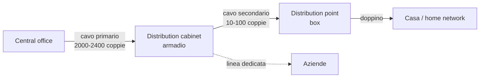
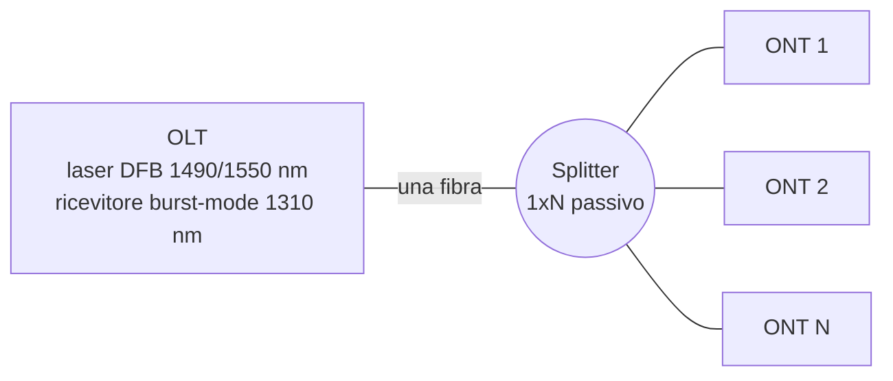

# Lezione 3 – FTTx e reti ottiche passive (PON)

## Di cosa parliamo

La lezione 2 ha mostrato che il rame ha un limite fisico: più è lungo, meno banda porta. La soluzione è portare la <b>fibra ottica</b> sempre più vicino all'utente (<b>FTTx</b>). Questa lezione spiega <b>perché</b> serve la fibra, <b>come</b> si costruisce una rete d'accesso in fibra economica (la <b>PON</b>, rete ottica passiva), i componenti ottici che servono (fibra, laser, fotodiodi, splitter), come si condivide la fibra tra tanti utenti (TDMA), gli standard (APON, BPON, EPON, GPON), il futuro (WDM-PON) e i costi.

## 1. Perché FTTx

### Banda e distanza delle tecnologie d'accesso

!!! abstract "In breve"

    Ogni tecnologia d'accesso ha una "zona" di funzionamento fatta di velocità e distanza. Solo la fibra copre tutto: velocità fino a 10 Gbit/s e distanze di decine di km.

Dal grafico <i>access/backhaul</i> (velocità vs distanza):

- <b>xDSL</b>: da circa 100 Mbit/s su poche decine di metri a 1 Mbit/s verso i 5 km.
- <b>Optical wireless</b> (laser in aria libera): fino a 10 Gbit/s ma solo fino a circa 1 km.
- <b>LMDS</b> (<i>Local Multipoint Distribution Service</i>, radio a microonde punto-multipunto): circa 1–100 Mbit/s fino a qualche km.
- <b>Microwave</b> (ponti radio): circa 100 Mbit/s su 1–15 km.
- <b>Fibra</b>: da 100 Mbit/s a 10 Gbit/s, su qualunque distanza (15 km e oltre).

<b>Backhaul</b> = il collegamento che porta il traffico dai nodi d'accesso (es. un DSLAM o una stazione radio) verso la rete core.

### La rete d'accesso in rame: struttura fisica

!!! abstract "In breve"

    Dalla centrale parte un cavo primario enorme (migliaia di coppie) verso l'armadio; dall'armadio partono cavi secondari più piccoli verso i box vicino agli edifici; dal box parte il doppino di ogni casa.

- <b>Rete primaria</b> (<i>feeder</i>): obiettivo <b>condivisione alta</b> e <b>costi minimi</b>. Cavi da 2000–2400 coppie, posati in tubi o canalizzazioni.
- <b>Rete secondaria</b> (<i>distribution</i>): obiettivo <b>flessibilità</b> e <b>ramificazione</b>. Cavi da 10–100 coppie, interrati o aerei (su pali).
- Mettere più livelli di armadi in cascata è possibile ma raro.

<b>Rete Telecom Italia in rame</b> (dati della slide):

- 628 <b>SGU</b> (<i>Stadi di Gruppo Urbano</i>, centrali di commutazione) e 10.313 <b>SL</b> (<i>Stadi di Linea</i>, le centrali locali dove ci sono DSLAM e <b>permutatore</b>);
- 140.000 armadi, circa 5,5 milioni di distributori/terminazioni (1,5 milioni di box interni agli edifici, 3,9 milioni esterni);
- circa 530.000 km di cavo e 110 milioni di km-coppia;
- i cavi della rete primaria sono <b>pressurizzati</b> (aria in pressione per tenere fuori l'umidità).

<b>Lunghezza dei doppini</b>: dal grafico, in Italia quasi tutti i doppini sono sotto i 4–5 km e circa il 70% sotto i 2 km: la rete italiana è <b>più corta</b> di quella USA e giapponese. Questo rende il VDSL dagli armadi (FTTCab) molto efficace in Italia.

## 2. Principi dei sistemi in fibra ottica

### Attenuazione della fibra

!!! abstract "In breve"

    La luce in fibra perde potenza molto lentamente, ma quanto dipende dalla lunghezza d'onda. Ci sono tre "finestre" dove la fibra attenua poco e si trasmette lì.

- Per le lunghe distanze si usa fibra <b>monomodale</b> (<b>SMF</b>, <i>Single Mode Fiber</i>), standard <b>ITU G.652</b>.
- Attenuazione in funzione della lunghezza d'onda $\lambda$:

| Finestra | $\lambda$ | Attenuazione (circa) |
| --- | --- | --- |
| Prima | 850 nm | circa 2 dB/km |
| Seconda | 1310 nm | circa 0,35 dB/km |
| Terza | 1550 nm | circa 0,2 dB/km (minimo) |

- Nella fibra standard (<b>G.652, STD</b>) c'è il <b>water peak</b>: un picco di attenuazione intorno a 1383 nm, dovuto a residui di acqua (ioni OH) nel vetro, che rende inutilizzabile la banda <b>1360–1480 nm</b>.
- La fibra <b>G.652c/d (ZWP, zero water peak)</b> elimina il picco: tutta la banda da 1300 a 1600 nm è utilizzabile, quindi ci stanno più canali.

### Dispersione

!!! abstract "In breve"

    Un impulso di luce che parte "stretto" arriva "allargato". Se si allarga troppo, invade il bit successivo e i bit si confondono. Questo limita il prodotto velocità × distanza.

- <b>Dispersione cromatica</b>: un laser non emette una sola lunghezza d'onda ma un piccolo intervallo; lunghezze d'onda diverse viaggiano a velocità leggermente diverse nel vetro. Risultato: l'impulso si <b>allarga</b> (<i>pulse broadening</i>).
- Più lo spettro del laser è largo, più dispersione.

Tipi di fibra (e dispersione <b>modale</b>, dovuta ai diversi percorsi della luce):

| Fibra | Nucleo | Come viaggia la luce | Impulso in uscita |
| --- | --- | --- | --- |
| Multimodo step index | circa 200 µm | Tanti raggi rimbalzano con angoli diversi: percorsi di lunghezza diversa | Molto allargato |
| Multimodo graded index | 50–100 µm | Indice di rifrazione che cala verso il bordo: i raggi curvano e arrivano quasi insieme | Poco allargato |
| Monomodo (SMF) | circa 10 µm | Un solo modo, praticamente in linea retta | Quasi identico (resta solo la cromatica) |

(Il diametro esterno del rivestimento, <i>cladding</i>, è 125 µm in entrambe le fibre standard.)

### Laser (sorgenti)

!!! abstract "In breve"

    Il trasmettitore è un diodo laser. Quello economico (Fabry-Perot) emette più righe ed è "sporco"; quello costoso (DFB) emette una riga sola, quindi soffre meno la dispersione.

|  | Fabry-Perot (FP) | Distributed Feedback (DFB) |
| --- | --- | --- |
| Costo | Economico | Più caro |
| Spettro | Più righe (multimodo longitudinale), rumoroso | Una riga stretta |
| Dispersione cromatica | Molto sensibile | Poco sensibile |
| Uso | 1310 nm (dove la dispersione della G.652 è quasi nulla) | 1550 nm (o 1310 nm) |

Struttura: entrambi hanno una zona di <b>guadagno</b> tra due specchi; nel FP gli specchi sono le facce tagliate del cristallo (<i>cleave</i>), nel DFB c'è un <b>reticolo</b> lungo il laser che seleziona una sola $\lambda$ (e una faccia ha un rivestimento antiriflesso, <i>AR coating</i>).

### Fotodiodi (ricevitori)

!!! abstract "In breve"

    Il ricevitore trasforma la luce in corrente. Il PIN è economico e sente fino a circa −22 dBm; l'APD amplifica internamente e sente segnali più deboli (circa −30 dBm), ma costa molto di più.

- <b>PIN</b>:
    - sensibilità circa <b>−22 dBm</b> (la potenza minima che riesce a ricevere correttamente);
    - in <b>silicio</b> per le $\lambda$ corte (850 nm), in <b>InGaAs</b> per le lunghe (1310/1550 nm).
- <b>APD</b> (<i>Avalanche Photodiode</i>):
    - sensibilità circa <b>−30 dBm</b> (effetto valanga: ogni fotone genera molti elettroni);
    - usati per distanze lunghe a velocità di Gbit/s;
    - molto più costosi.

<b>Ricorda</b>: dBm = potenza in decibel rispetto a 1 mW. 0 dBm = 1 mW; −30 dBm = 1 µW. Una sensibilità "più negativa" è migliore.

### Splitter passivi

!!! abstract "In breve"

    Lo splitter ottico divide la luce di una fibra su più fibre, senza alimentazione. Il prezzo è la potenza: ogni divisione in due dimezza il segnale, cioè toglie 3 dB.

- L'elemento base (1×2) è fatto di <b>due fibre fuse insieme</b>; uno dei due ingressi non si usa.
- Uno splitter <b>1×N</b> è una cascata di 1×2: per $N = 2^k$ servono $k$ livelli.
- Ogni divisione in due: $10 \log_{10}(0{,}5) \approx -3$ dB.

$$
\text{Perdita} \approx 3 \text{ dB} \times \log_2(N_{ONU})
$$

- Valori reali di uno splitter 1×2: <b>3,7 dB</b> convenzionale, <b>3,4 dB</b> low-loss (più dei 3 dB ideali per le perdite in eccesso).

<b>Esempio</b>: 1×32 → $\log_2 32 = 5$ livelli → circa 15 dB ideali, circa 18,5 dB con splitter convenzionali.

### Power budget

!!! abstract "In breve"

    Il power budget è quanta attenuazione totale può sopportare il collegamento: differenza tra la potenza che esce dal trasmettitore e la potenza minima che serve al ricevitore. Splitter, fibra e connettori devono starci dentro.

$$
\text{Budget [dB]} = P_{TX} \text{ [dBm]} - S_{RX} \text{ [dBm]}
$$

Ipotesi della slide:

|  | TX power | RX sensitivity |
| --- | --- | --- |
| ONU (FP + PIN, economica) | 0 dBm | −22 dBm |
| OLT (DFB + APD, costosa) | 1 dBm | −30 dBm |

- <b>Upstream</b> (ONU → OLT, a 1310 nm): $0 - (-30) = 30$ dB.
- <b>Downstream</b> (OLT → ONU, a 1490 nm): $1 - (-22) = 23$ dB; la slide riporta <b>22 dB</b> (arrotondamento/margine).
- Logica di progetto: gli apparati costosi (DFB, APD) si mettono nell'<b>OLT</b>, che è uno solo e condiviso; le ONU, che sono tante, usano componenti economici.

<b>Esempio di verifica</b> (<i>complemento</i>): downstream con splitter 1×32 (circa 17 dB) + 10 km di fibra a 0,3 dB/km (3 dB) = 20 dB, sotto i 22 dB disponibili: funziona, con circa 2 dB di margine. Con 1×64 (circa 21 dB di splitter) non ci si starebbe più: ecco perché split ratio e distanza sono limitati.

## 3. Posa della fibra

!!! abstract "In breve"

    Il costo vero della fibra non è il vetro, è lo scavo. Per ridurlo si usano tecniche leggere come la microtrincea e il soffiaggio.

- <b>Minitrincea/microtrincea</b>: un taglio nell'asfalto largo circa <b>5 cm</b> e profondo <b>25–30 cm</b>; dentro si mette un tubo con il cavo in fibra, poi materiale di riempimento, binder e un tappetino d'asfalto. Costo circa <b>30–40 k€/km</b>: molto meno di uno scavo tradizionale.
- <b>Soffiaggio</b> (<i>fiber blowing</i>): la fibra viene spinta dentro un minitubo già posato usando aria compressa; comodo anche dentro gli edifici.

## 4. Architetture FTTx

!!! abstract "In breve"

    Si sposta il DSLAM (o il punto in cui finisce la fibra) sempre più vicino all'utente: prima in centrale, poi nell'armadio, poi nel secondo armadio, poi nell'edificio, infine in casa.

Distanze tipiche: centrale → primo armadio 500–1000 m, primo → secondo armadio 100–300 m, secondo armadio → edificio 50–200 m.

| Architettura | Dove sta il DSLAM / ONU | Cosa resta in rame |
| --- | --- | --- |
| a) Attuale (FTTE) | DSLAM in centrale | Tutto, dalla centrale a casa |
| b) Fiber to the cabinet | DSLAM nel primo armadio | Dal primo armadio a casa |
| c) Fiber to the curb | DSLAM nel secondo armadio | Dal secondo armadio a casa |
| d) Fiber to the building | DSLAM (D) nell'edificio | Solo il cablaggio interno |
| e) Fiber to the home | – | Niente: fibra fino a ogni appartamento |

In tutte le architetture con fibra, in centrale il DSLAM viene sostituito da uno <b>switch/router</b> che manda il traffico in fibra.

### Come portare la fibra a più case

Tre modi:

- <b>a) Punto-punto</b>: una fibra dedicata dalla centrale a ogni casa. Massime prestazioni, ma tantissime fibre e porte in centrale.
- <b>b) Curb switch</b>: una fibra fino a uno <b>switch attivo</b> vicino alle case, che poi distribuisce (<b>AON</b>). Serve alimentazione sul campo.
- <b>c) PON</b>: una fibra fino a uno <b>splitter ottico passivo</b>, che la divide verso le case. Nessun apparato alimentato sul campo, poche fibre in centrale.

### Capacità d'accesso (Telecom Italia)

| Architettura | Tecnologia | Downstream | Upstream |
| --- | --- | --- | --- |
| FTTE | ADSL2+ dalla centrale (rame 200–3000 m + 100–700 m) | 3–20 Mbit/s | sotto 1 Mbit/s |
| FTTCab | VDSL2 profilo 17 MHz dall'ONU nell'armadio | 25–50 Mbit/s | 2–10 Mbit/s |
| FTTB | VDSL2 profilo 30 MHz dall'ONU nell'edificio | 50–100 Mbit/s | 25–40 Mbit/s |
| FTTH | Ottica fino a casa | 0,1–1 Gbit/s | 0,1–1 Gbit/s |

### Esempio: Fastweb (2000), il primo FTTH in Europa

!!! abstract "In breve"

    Fastweb non ha usato una PON, ma una rete <b>Gigabit Ethernet</b> attiva: switch IP in ogni edificio, collegati tra loro ad anello verso il core.

- Architettura <b>daisy chain</b>: gli switch GbE sono collegati <b>in catena ad anello</b> che parte e torna al core (se un link si rompe, il traffico gira dall'altra parte); ogni switch serve un gruppo di case.
- <b>FTTH residenziale</b>: fibra fino a un <b>IP switch</b> nello scantinato dell'edificio; da lì a ogni appartamento, dove l'<b>HAG</b> (<i>Home Access Gateway</i>) collega PC, TV (IPTV) e telefono (VoIP).
- <b>FTTB business</b>: fibra fino a un <b>router</b> nella sala tecnica dell'edificio, che collega la LAN aziendale e il centralino telefonico (<b>PABX</b>).

### Distribuzione nell'edificio

- <b>Building Optical Distribution Point</b> (spesso in un box su palo o in facciata): collega la fibra in arrivo alle singole fibre degli appartamenti o uffici.
- Contiene e protegge connessioni, giunzioni e, a seconda del progetto, gli <b>splitter ottici</b>.
- È <b>passivo</b>: non richiede alimentazione.

## 5. PON: funzionamento di base

!!! abstract "In breve"

    In una PON un unico apparato in centrale (OLT) parla con fino a 32–64 utenti (ONT) attraverso uno splitter passivo. In discesa l'OLT trasmette a tutti; in salita gli utenti parlano a turno, ognuno nel suo intervallo di tempo.

- <b>Downstream</b>: l'<b>OLT</b> trasmette in <b>broadcast</b> su circa <b>1490–1510 nm</b> ("1,5xx nm").
- <b>Upstream</b>: le <b>ONT</b> trasmettono <b>a burst</b> su <b>1310 nm</b>, ognuna nel suo <b>time slot</b> assegnato.
- Le due direzioni usano $\lambda$ diverse sulla <b>stessa fibra</b> (WDM a due lunghezze d'onda).
- Esempio FSAN BPON: upstream 155 Mbit/s, downstream 155/622 Mbit/s; fino a <b>32 ONT</b>, ognuna può servire più utenti.
- (La terza $\lambda$, 1550 nm, è tipicamente usata per il video broadcast analogico/RF, <i>complemento</i>.)

<b>Elementi di una PON</b> (schema completo):

- In <b>centrale</b>: l'<b>OLT</b>, collegato verso la rete a un nodo ATM (interfacce VB5.1/VB5.2), a una rete dati/CDN e alla PSTN/ISDN (interfacce V5.1/V5.2).
- <b>Rete primaria</b>: fibra fino a un <b>diramatore 1:N</b> (lo splitter).
- <b>Rete secondaria</b>: fibre verso ONU in <b>cabinet</b>, <b>curb</b> o <b>building</b>.
- Dall'ONU si prosegue con <b>VDSL</b> su coppia in rame fino all'<b>NT</b> dell'utente, a cui si collegano la rete domestica e il <b>set-top box (STB)</b>.

## 6. Condividere la fibra: TDMA vs WDMA

!!! abstract "In breve"

    In discesa non c'è problema, parla solo l'OLT. In salita invece tanti ONU parlano verso uno solo e i loro segnali si sommano nello splitter: se trasmettono insieme, collidono. Serve una regola di accesso: o turni di tempo (TDMA) o colori diversi (WDMA).

### Spiegato semplice: l'aula

Immagina un'<b>aula</b>: l'<b>OLT</b> è il professore, le <b>ONU</b> sono gli studenti, lo <b>splitter</b> è la stanza che li collega.

<b>Downstream (OLT → ONU): parla il professore</b>

- La voce del professore arriva <b>a tutti</b>. Lo splitter fa proprio questo: <b>copia</b> la luce dell'OLT su tutte le fibre, verso tutte le case.
- Il professore dice: "Mario, il tuo voto è 28. Luca, il tuo voto è 25." Tutti sentono tutto, ma ognuno <b>tiene solo la frase con il suo nome</b>.
- Nella PON: l'OLT manda pacchetti con l'indirizzo della ONU destinataria; ogni ONU li riceve tutti e tiene solo i suoi.
- <b>Nessun problema</b>: parla una persona sola. È un <b>broadcast</b> (uno parla, tutti sentono), in una rete <b>punto-multipunto</b>.

<b>Upstream (ONU → OLT): parlano gli studenti</b>

- Se gli studenti parlano <b>tutti insieme</b>, il professore sente solo confusione.
- Nella PON lo splitter, al contrario, fa da <b>imbuto</b>: unisce la luce di tutte le ONU in un'unica fibra verso l'OLT. Se due ONU trasmettono nello stesso momento, le loro luci <b>si sommano</b> e all'OLT arriva un segnale illeggibile: è la <b>collisione</b>.
- È una rete <b>multipunto-punto</b>.
- <b>Perché le ONU non si sentono tra loro?</b> Lo splitter manda la luce di una ONU <b>solo verso l'OLT</b>, non verso le altre ONU. Una ONU non può "ascoltare" se un'altra sta parlando e aspettare da sola: è come se gli studenti fossero in cabine insonorizzate che comunicano solo con il professore.

<b>La soluzione: il professore assegna i turni (TDMA)</b>

- "Mario, parli tu da 0 a 2 secondi. Luca, tu da 2 a 4. Giulia, tu da 4 a 6." Nessuno si sovrappone.
- Nella PON l'OLT assegna a ogni ONU un <b>time slot</b>; ogni ONU accumula i suoi dati e li manda <b>solo nel suo turno</b>. È il <b>TDMA</b> (<i>Time Division Multiple Access</i>).

|  | Chi parla | Problema | Soluzione |
| --- | --- | --- | --- |
| Downstream | Solo l'OLT | Nessuno | Broadcast, ogni ONU prende il suo |
| Upstream | Tante ONU | Si sommano nello splitter (collisioni) e non si sentono tra loro | L'OLT assegna i turni (TDMA) |

- <b>Downstream</b> = rete <b>punto-multipunto</b>: l'OLT gestisce tutta la banda.
- <b>Upstream</b> = rete <b>multipunto-punto</b>:
    - le ONU trasmettono solo verso l'OLT e <b>non possono comunicare direttamente</b> tra loro;
    - una ONU <b>non sente</b> le trasmissioni delle altre (lo splitter manda la loro luce verso l'OLT, non verso le altre ONU), quindi non può fare carrier sense come in Ethernet classica;
    - i dati di ONU diverse possono <b>collidere</b> nello splitter/combiner.
- Soluzioni:
    - <b>TDMA</b> (<i>Time Division Multiple Access</i>): ogni ONU trasmette in istanti diversi;
    - <b>WDMA</b> (<i>Wavelength Division Multiple Access</i>): ogni ONU trasmette su una $\lambda$ diversa.

### TDM-PON vs WDM-PON

|  | TDM-PON | WDM-PON |
| --- | --- | --- |
| Stato | Standardizzate | Proposte in letteratura / dimostrate |
| Lunghezze d'onda | Poche (2 o 3) | Una (o due) per ONU |
| Componenti | Economici e maturi (splitter, laser) | Dispositivi WDM (es. AWG) |
| Power budget | Limitato: max 20 km, split ratio max 64 | Lunga portata e più banda |
| Traffico | Broadcast in discesa, TDMA in salita | Canale dedicato per ONU |
| Esempi | APON/BPON, EPON, GPON | CPON, LARNET, RITENET, SUCCESS-DWA |

### Downstream: scheduling TDM

- L'OLT mette il traffico di ogni ONU in <b>time slot</b> (multiplazione TDM).
- Lo splitter copia <b>tutto</b> il flusso su tutte le uscite: ogni ONU riceve tutto (A B C B) e tiene solo i suoi slot.
- Gli slot vanno da circa <b>µs a ms</b>.
- Conseguenza per la sicurezza (<i>complemento</i>): ogni ONU "vede" fisicamente il traffico degli altri, per questo gli standard PON cifrano il downstream.

### Upstream: scheduling TDMA

- Tutte le ONU condividono lo <b>stesso canale</b> upstream; collisioni possibili nello splitter.
- Gli standard PON usano <b>TDMA</b>: il tempo in salita viene diviso in slot e assegnato alle ONU, così i burst arrivano all'OLT uno dopo l'altro senza sovrapporsi (A, B, C, B).
- Per farlo, l'OLT deve conoscere la distanza di ogni ONU e compensare i diversi ritardi di propagazione (<i>ranging</i>, <i>complemento</i>).

### Ricezione dei burst upstream

!!! abstract "In breve"

    Le ONU sono a distanze diverse (es. 1, 3, 7 km), quindi i loro burst arrivano all'OLT con potenze diverse. Il ricevitore deve riadattarsi a ogni burst: è un ricevitore "burst mode".

- I frame arrivano all'OLT con <b>potenze diverse</b> (una ONU a 7 km arriva più debole di una a 1 km).
- È difficile recuperare il <b>sincronismo</b> (<i>clock and data recovery</i>, CDR) e decidere cosa è 0 e cosa è 1.
- Serve un <b>burst mode receiver</b> (complesso) nell'OLT: con un <b>AGC</b> (<i>Automatic Gain Control</i>) reimposta la <b>soglia 0/1</b> all'inizio di ogni burst.

## 7. Gli standard PON

### Evoluzione

| Standard | Periodo | Velocità | Ente / trasporto |
| --- | --- | --- | --- |
| APON | circa 1990–1996 | 54 Mbit/s | FSAN/ITU, celle ATM |
| APON | circa 1997–2000 | 155 Mbit/s | FSAN/ITU, celle ATM |
| BPON (Broadband PON) | circa 2001–2004 | 622 Mbit/s | ITU G.983, ATM |
| EPON (Ethernet PON) | circa 2004–2006 | 1,25 Gbit/s | IEEE 802.3ah, Ethernet |
| GPON (Gigabit PON) | circa 2005–2008 | 2,5 Gbit/s | ITU G.984, GEM (Ethernet, ATM, TDM) |
| 10G EPON | dopo | 10 Gbit/s | IEEE 802.3av |

(Ente e numero di raccomandazione per BPON/GPON/10G EPON sono un <i>complemento</i>.)

### EPON (Ethernet PON)

!!! abstract "In breve"

    EPON porta la PON nel mondo Ethernet: tutto viaggia in normali trame Ethernet, il che la rende semplice ed economica.

- Standardizzata da <b>IEEE 802.3ah EFM</b> (<i>Ethernet in the First Mile</i>), lavori dal 2001, ratificata nel <b>2004</b>.
- Si colloca nella famiglia IEEE 802: livello 1 e MAC di <b>802.3 (Ethernet)</b>, sotto 802.1 (bridging) e 802.2 (LLC). È un nuovo livello fisico Ethernet accanto a 10 Mb/s, 100 Mb/s, 1 Gb/s e 10 Gb/s.
- Tutti i pacchetti sono <b>incapsulati in trame Ethernet</b>: supporta pacchetti di <b>lunghezza variabile</b> (niente celle fisse come ATM).
- Piano di lunghezze d'onda simile a BPON.
- Bit rate massimo <b>1 Gbit/s MAC-MAC</b> (1,25 Gbit/s a livello fisico per la codifica <b>8b/10b</b>: ogni 8 bit se ne trasmettono 10, quindi $1 \times 10/8 = 1{,}25$).
- Split minimo: <b>16</b>.
- Portata massima:
    - <b>10 km</b> con laser <b>FP</b> nelle ONU (limitata dalla dispersione in G.652);
    - <b>20 km</b> con laser <b>DFB</b> nelle ONU.
- Configurazioni ammesse: <b>albero</b>, <b>anello</b>, <b>albero con trunk ridondante</b> (doppia fibra OLT-splitter), <b>bus</b>.

<b>Downstream EPON</b>:

- Come una rete a <b>mezzo condiviso</b>: l'OLT trasmette in broadcast trame 802.3 (header, payload, FCS); ogni ONU tiene solo quelle destinate a lei e le passa al suo utente.

<b>Upstream EPON</b>:

- Le ONU sono <b>sincronizzate</b> su un riferimento temporale comune.
- <b>Arbitraggio centralizzato</b> nell'OLT: l'OLT concede (<i>grant</i>) a ogni ONU un <b>time slot</b>.
- Ogni ONU accumula le trame dei suoi utenti in un <b>buffer</b> e, nel suo slot, ne trasmette <b>diverse</b> di fila.
- (Il protocollo che gestisce richieste e concessioni è <b>MPCP</b>, <i>Multi-Point Control Protocol</i>, con messaggi REPORT e GATE; <i>complemento</i>.)

### Overhead dei burst: BPON, GPON, EPON

!!! abstract "In breve"

    Ogni burst upstream ha un "preambolo" che serve al ricevitore per agganciarsi. EPON lo fa in modo semplice e lento (tempi lunghi, componenti economici); BPON e GPON con tempi molto più stretti.

| Standard | Guard | Preamble | Delimiter | Totale |
| --- | --- | --- | --- | --- |
| BPON | min 4 bit | tip. 12 bit | tip. 8 bit | 24 bit |
| GPON | min 25,6 ns | tip. 35,2 ns | tip. 16,0 ns | min 76,8 ns |

- <b>Guard</b>: tempo di silenzio tra un burst e l'altro, per evitare sovrapposizioni.
- <b>Preamble</b>: sequenza nota che serve a regolare guadagno e clock.
- <b>Delimiter</b>: segnala l'inizio dei dati.

<b>EPON</b>: tempi molto più larghi, fino a <b>400 ns</b> di accensione laser + <b>400 ns</b> per AGC e CDR + <b>400 ns</b> di spegnimento laser. L'accensione di un burst può sovrapporsi allo spegnimento del precedente.

<b>Trade-off</b>: EPON spreca più tempo per burst ma accetta componenti lenti e quindi economici: secondo la slide costa circa il <b>10%</b> di BPON/GPON.

### Meccanismi di protezione

!!! abstract "In breve"

    Per non lasciare senza servizio tutti gli utenti di una PON se si rompe qualcosa, si duplicano parti della rete (protezione 1+1: un percorso di lavoro e uno di riserva).

- <b>Tipo B, 1+1 dell'OLT</b>: due transceiver nell'OLT e due fibre feeder fino allo splitter (con 2 ingressi). Le ONU non sono duplicate.
    - Economico; protegge <b>feeder</b> e <b>transceiver OLT</b>, la parte condivisa da tutti.
- <b>Tipo C, 1+1 dell'intera PON</b>: due transceiver nell'OLT, due splitter, due fibre di discesa e due transceiver in ogni ONU.
    - Il più sicuro e il più costoso; protegge feeder, drop e transceiver.

### Carrier Ethernet per EPON

- L'idea: trattare il traffico a <b>livello 2</b> (Ethernet) invece che a livello 3 (IP), creando <b>percorsi specifici</b> per garantire la <b>QoS</b> dall'utente attraverso la rete.
- Tecnologie: <b>VLAN tag</b>, <b>VPLS</b> (<i>Virtual Private LAN Service</i>), <b>Q-in-Q</b> (doppio tag VLAN, 802.1ad), <b>MAC-in-MAC</b> (802.1ah), <b>PBT</b> (<i>Provider Backbone Transport</i>).

## 8. Il futuro: WDM-PON

!!! abstract "In breve"

    Invece di dividere la luce in potenza (splitter) si divide per colore. Ogni ONU ha la sua lunghezza d'onda: è come avere una fibra dedicata, ma su un'unica fibra fisica.

- Al posto dello splitter c'è un <b>AWG 1×N</b> (<i>Arrayed Waveguide Grating</i>): un <b>filtro</b> che fa da <b>router ottico</b>, mandando ogni $\lambda$ su un'uscita diversa.
- L'OLT ha una <b>sorgente modulata WDM</b> che trasmette $\lambda_1 \dots \lambda_N$ in discesa e un <b>array di ricevitori / demux ottico</b> per $\lambda_{N+1} \dots \lambda_{2N}$ in salita.
- L'ONU $i$ riceve su $\lambda_i$ e trasmette su $\lambda_{N+i}$.
- Caratteristiche:
    - numero di ONU <b>limitato dal numero di </b>$\lambda$;
    - topologia logica <b>punto-punto</b> (nessuna condivisione, nessuna collisione, niente broadcast);
    - <b>lunga portata</b>, quasi come un collegamento punto-punto: l'AWG perde molto meno di uno splitter con molte uscite.

### Evoluzione della fotonica

Tabella distanza vs tempo dal grafico:

- <b>Accesso</b> (fino a 1 km): ADSL2+ (2008) → VDSL/2 e FTTP → VDSL2 e FTTB (2010) → FTTH → FTTH con <b>WDM</b> (2015).
- <b>Metro/core</b> (1 km – 1000+ km): da GbE ed SDH con MPLS e VPLS, verso T-MPLS e Provider Backbone Transport, poi OTN, conversione di lunghezza d'onda, <b>optical burst switching</b> e <b>optical packet switching</b>: la commutazione scende progressivamente dal livello 3 al livello 2 al livello 1 (ottico).

## 9. Mercato e costi

### Situazione internazionale (EXFO, 2007)

- <b>USA</b>: cavi in media lunghi (il DSL rende meno); grandi investimenti degli operatori via cavo, che hanno una quota rilevante della banda larga; <b>nessun obbligo di unbundling</b> per le nuove infrastrutture in fibra (incentiva gli investimenti).
- <b>Brasile, Colombia, Argentina, Cile</b>: meno di 300.000 utenti FTTH.
- <b>Australia, Nuova Zelanda, Kuwait, Russia, EAU, Pakistan</b>: meno di 2 milioni di utenti FTTH.

<b>Unbundling</b> (<i>unbundling del local loop</i>): obbligo per l'operatore storico di affittare la propria rete d'accesso ai concorrenti, che vi collegano i loro apparati (vedi i CLEC e la collocation della lezione 1).

### Costi FTTx (CAPEX relativo, TIM)

!!! abstract "In breve"

    Più la fibra si avvicina all'utente, più costa, e quasi tutto il costo è infrastruttura (scavi, posa), non elettronica.

| Architettura | Rame residuo | CAPEX relativo (FTTE = 1) |
| --- | --- | --- |
| FTTE | 300–3000 m | circa 1 |
| FTTCab | 100–700 m | circa 5–6 |
| FTTB | 20–150 m | circa 10 |
| FTTH | 0 | circa 17–18 |

- Il CAPEX è diviso in <b>elettronica</b>, <b>infrastruttura</b> e <b>CPE</b> (apparati del cliente): in FTTB e FTTH la parte dominante è l'<b>infrastruttura</b>.
- <b>CAPEX</b> = <i>Capital Expenditure</i>, spese di investimento (costruire la rete), contrapposte all'OPEX (spese operative di esercizio).

## Domande di ripasso

??? note "Calcola la perdita di uno splitter 1x64"

    Ideale: $3 \times \log_2 64 = 3 \times 6 = 18$ dB. Con splitter 1x2 reali da 3,7 dB: $6 \times 3{,}7 \approx 22$ dB, già oltre i 22 dB di budget downstream: ecco perché 64 è il massimo split ratio per le TDM-PON.

??? note "Perché nell'OLT si usano DFB e APD e nelle ONU FP e PIN?"

    L'OLT è uno e condiviso tra tante ONU, quindi può permettersi componenti costosi: DFB (spettro stretto, poca dispersione) e APD (sensibilità −30 dBm). Le ONU sono tante (una per utente), quindi devono costare poco: FP e PIN. Il budget upstream (30 dB) viene dalla sensibilità dell'APD.

??? note "Perché in upstream serve TDMA e in downstream no?"

    In downstream trasmette solo l'OLT (punto-multipunto): basta il broadcast, ogni ONU prende i suoi dati. In upstream trasmettono molte ONU verso una (multipunto-punto); i segnali si sommano nello splitter, le ONU non si sentono a vicenda e quindi collidono se non si alternano in slot assegnati dall'OLT.

??? note "Cos'è un burst mode receiver e perché serve?"

    Un ricevitore che a ogni burst ricalcola guadagno (AGC) e soglia 0/1 e recupera il clock (CDR). Serve perché le ONU sono a distanze diverse e i loro burst arrivano all'OLT con potenze diverse.

??? note "Perché EPON a 1 Gbit/s trasmette a 1,25 Gbit/s?"

    Per la codifica 8b/10b: ogni 8 bit di dati diventano 10 bit sulla linea (per bilanciare 0 e 1 e aiutare il recupero del clock), quindi $1 \times 10/8 = 1{,}25$ Gbit/s.

??? note "Differenza tra splitter (TDM-PON) e AWG (WDM-PON)"

    Lo splitter divide la potenza: ogni uscita riceve tutte le lunghezze d'onda ma con potenza ridotta di circa 3 dB per divisione. L'AWG instrada per lunghezza d'onda: ogni uscita riceve solo la sua $\lambda$ con poca perdita, così ogni ONU ha un canale dedicato e la portata aumenta.

??? note "Protezione tipo B vs tipo C"

    B: duplica solo transceiver OLT e fibra feeder (la parte comune a tutti), economico. C: duplica tutto, anche splitter, drop e transceiver delle ONU: massima affidabilità, costo massimo.

## Riepilogo

- <b>Perché FTTx</b>: il rame perde banda con la distanza; solo la fibra copre velocità fino a 10 Gbit/s su qualunque distanza.
- <b>Fibra</b>: SMF G.652, finestre a 850/1310/1550 nm, water peak 1360–1480 nm (eliminato dalla ZWP); la dispersione allarga gli impulsi.
- <b>Componenti</b>: laser FP (economico, 1310 nm) vs DFB (spettro stretto, 1550 nm); fotodiodi PIN (−22 dBm) vs APD (−30 dBm); splitter: circa 3 dB per divisione, $3 \log_2 N$ dB.
- <b>Power budget</b> = $P_{TX} - S_{RX}$: 30 dB upstream, 22 dB downstream.
- <b>FTTE → FTTCab → FTTC → FTTB → FTTH</b>: più velocità, molto più costo (FTTH circa 17 volte FTTE, quasi tutto in scavi). Microtrincea circa 30–40 k€/km.
- <b>PON</b>: OLT + splitter passivo + ONT; downstream broadcast a 1490 nm, upstream TDMA a burst a 1310 nm; OLT con burst mode receiver.
- <b>Standard</b>: APON → BPON (622 Mbit/s) → EPON (1,25 Gbit/s, IEEE 802.3ah, trame Ethernet, max 20 km) → GPON (2,5 Gbit/s) → 10G EPON.
- <b>Protezione</b>: tipo B (OLT + feeder) e tipo C (tutto).
- <b>WDM-PON</b>: AWG al posto dello splitter, una $\lambda$ per ONU, punto-punto logico e lunga portata.
